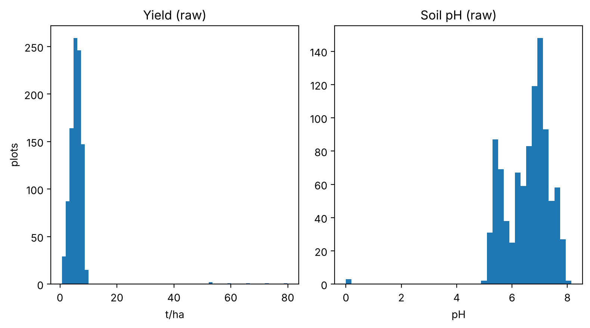
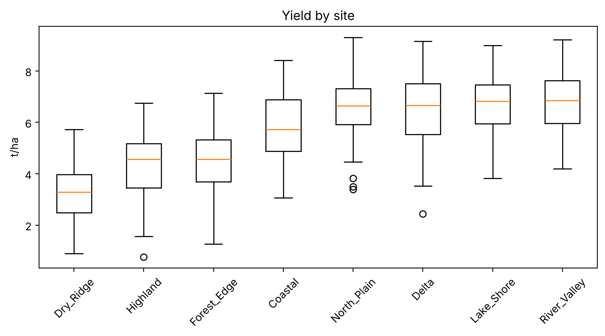
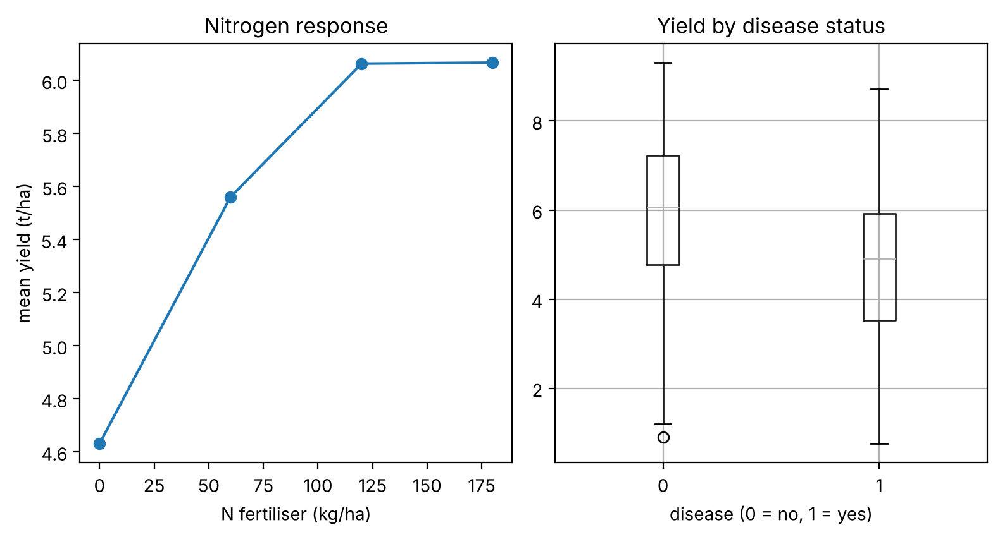
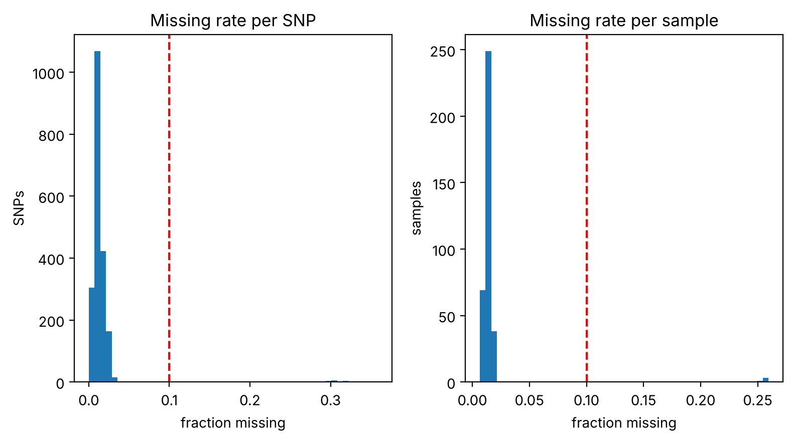
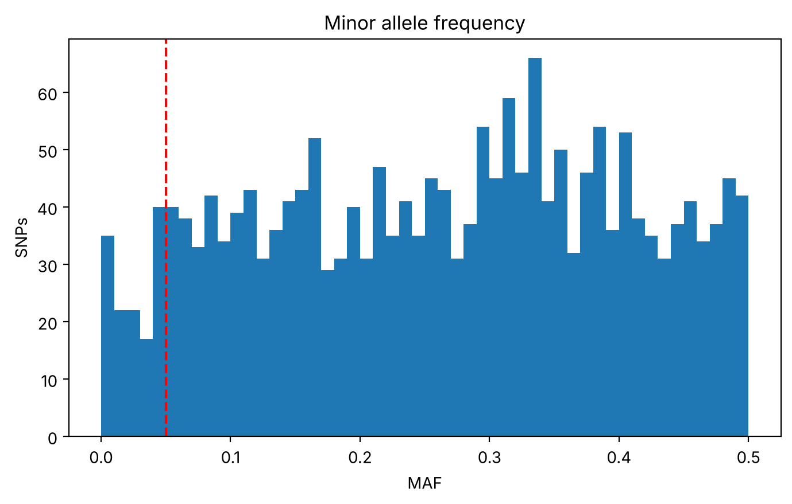
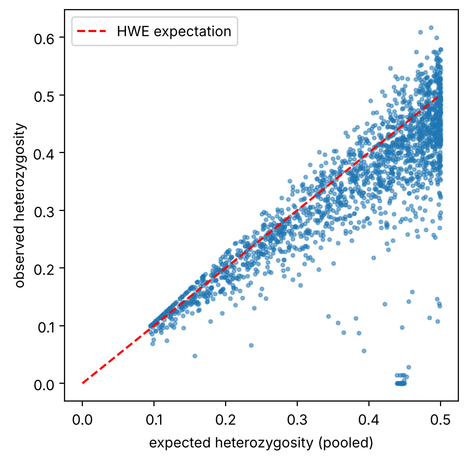
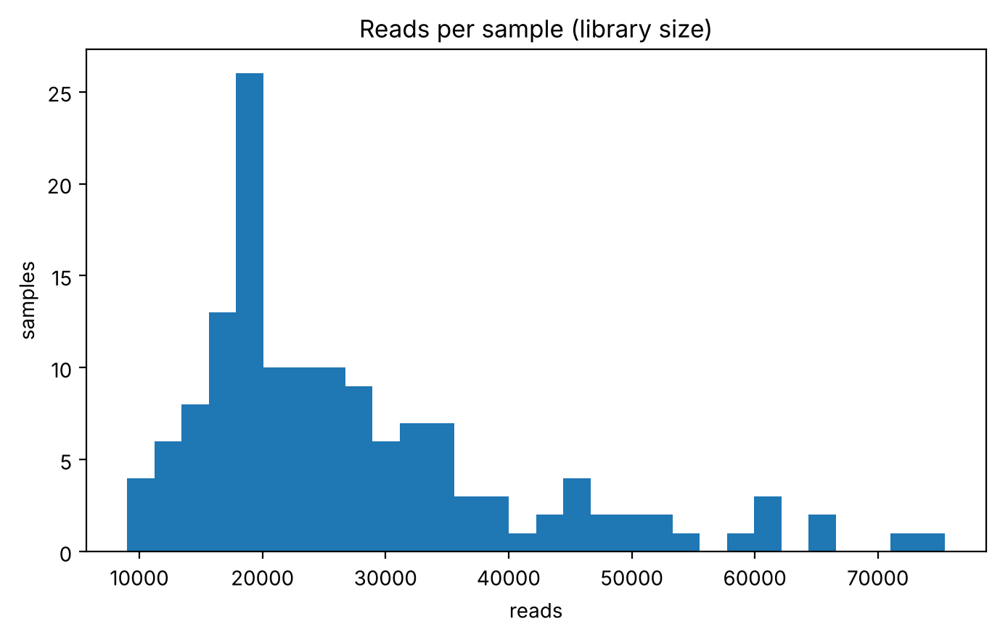
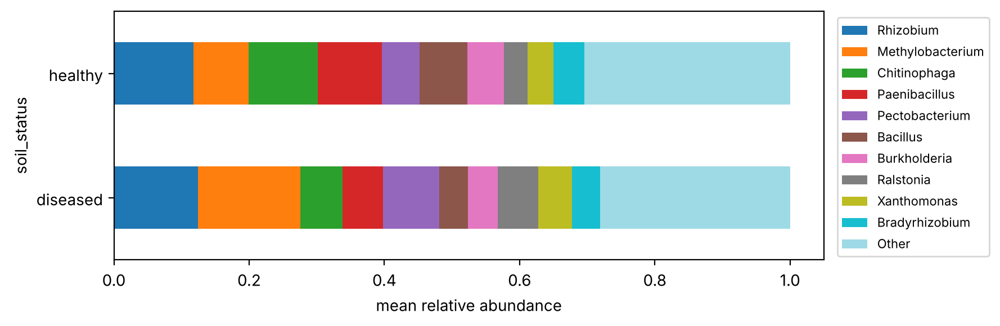

Every AI project starts with looking hard at the data. In this lab you explore
three typical datasets and find the problems hiding in each:

- **Part A — Field trials:** missing values, typos and outliers in agronomic data
- **Part B — Population genetics:** quality control of a SNP genotype matrix
- **Part C — Metagenomics:** why raw microbiome counts can't be compared directly

All datasets are simulated to look like real data, problems included.

```python
import os

import numpy as np
import pandas as pd
import matplotlib.pyplot as plt
from scipy import stats

REPO = "abu85/ai-for-agri-bio"


def data_path(name):
    """Use the local data folder if it exists, otherwise download from GitHub."""
    for folder in ["data", "../data", "../../data"]:
        if os.path.exists(os.path.join(folder, name)):
            return os.path.join(folder, name)
    return f"https://raw.githubusercontent.com/{REPO}/main/data/{name}"


plt.rcParams["figure.figsize"] = (8, 4.5)
```

### Part A — Field trials

Each row is one plot in a multi-site variety trial: where and when it was grown,
the variety, fertiliser, soil and weather measurements, whether disease was
scored, and the yield.

```python
trials = pd.read_csv(data_path("crop_trials.csv"))
print(trials.shape)
trials.head()
```

```{.text .lab-output}
(961, 14)
```

```{=html}
<div class="lab-table"><div>
<style scoped>
    .dataframe tbody tr th:only-of-type {
        vertical-align: middle;
    }

    .dataframe tbody tr th {
        vertical-align: top;
    }

    .dataframe thead th {
        text-align: right;
    }
</style>
<table border="1" class="dataframe">
  <thead>
    <tr style="text-align: right;">
      <th></th>
      <th>plot_id</th>
      <th>site</th>
      <th>year</th>
      <th>variety</th>
      <th>n_fert_kg_ha</th>
      <th>soil_p_mg_kg</th>
      <th>soil_k_mg_kg</th>
      <th>soil_ph</th>
      <th>organic_matter_pct</th>
      <th>rainfall_mm</th>
      <th>mean_temp_c</th>
      <th>irrigated</th>
      <th>disease</th>
      <th>yield_t_ha</th>
    </tr>
  </thead>
  <tbody>
    <tr>
      <th>0</th>
      <td>P0001</td>
      <td>North_Plain</td>
      <td>2021</td>
      <td>V01</td>
      <td>0</td>
      <td>23.8</td>
      <td>186.0</td>
      <td>6.49</td>
      <td>3.39</td>
      <td>508.0</td>
      <td>14.4</td>
      <td>0</td>
      <td>0</td>
      <td>5.13</td>
    </tr>
    <tr>
      <th>1</th>
      <td>P0002</td>
      <td>North_Plain</td>
      <td>2021</td>
      <td>V01</td>
      <td>60</td>
      <td>15.6</td>
      <td>214.0</td>
      <td>6.77</td>
      <td>2.80</td>
      <td>508.0</td>
      <td>14.4</td>
      <td>0</td>
      <td>0</td>
      <td>7.01</td>
    </tr>
    <tr>
      <th>2</th>
      <td>P0003</td>
      <td>North_Plain</td>
      <td>2021</td>
      <td>V01</td>
      <td>120</td>
      <td>21.3</td>
      <td>180.0</td>
      <td>6.63</td>
      <td>2.83</td>
      <td>508.0</td>
      <td>14.4</td>
      <td>0</td>
      <td>0</td>
      <td>6.82</td>
    </tr>
    <tr>
      <th>3</th>
      <td>P0004</td>
      <td>North_Plain</td>
      <td>2021</td>
      <td>V01</td>
      <td>180</td>
      <td>29.8</td>
      <td>189.0</td>
      <td>6.48</td>
      <td>3.61</td>
      <td>508.0</td>
      <td>14.4</td>
      <td>0</td>
      <td>0</td>
      <td>9.31</td>
    </tr>
    <tr>
      <th>4</th>
      <td>P0005</td>
      <td>North_Plain</td>
      <td>2021</td>
      <td>V02</td>
      <td>0</td>
      <td>31.6</td>
      <td>133.0</td>
      <td>6.53</td>
      <td>2.90</td>
      <td>508.0</td>
      <td>14.4</td>
      <td>0</td>
      <td>1</td>
      <td>4.78</td>
    </tr>
  </tbody>
</table>
</div></div>
```

**How much is missing?** Count missing values per column.

```python
trials.isna().sum()
```

```{.text .lab-output}
plot_id                0
site                   0
year                   0
variety                0
n_fert_kg_ha           0
soil_p_mg_kg          48
soil_k_mg_kg          19
soil_ph                0
organic_matter_pct    38
rainfall_mm            0
mean_temp_c            0
irrigated              0
disease                0
yield_t_ha             8
dtype: int64
```

**Do the values make sense?** Summary statistics catch impossible values fast.
Look at the minimum and maximum of each column.

```python
trials.describe().round(2).T
```

```{=html}
<div class="lab-table"><div>
<style scoped>
    .dataframe tbody tr th:only-of-type {
        vertical-align: middle;
    }

    .dataframe tbody tr th {
        vertical-align: top;
    }

    .dataframe thead th {
        text-align: right;
    }
</style>
<table border="1" class="dataframe">
  <thead>
    <tr style="text-align: right;">
      <th></th>
      <th>count</th>
      <th>mean</th>
      <th>std</th>
      <th>min</th>
      <th>25%</th>
      <th>50%</th>
      <th>75%</th>
      <th>max</th>
    </tr>
  </thead>
  <tbody>
    <tr>
      <th>year</th>
      <td>961.0</td>
      <td>2022.51</td>
      <td>1.12</td>
      <td>2021.00</td>
      <td>2022.00</td>
      <td>2023.00</td>
      <td>2023.00</td>
      <td>2024.00</td>
    </tr>
    <tr>
      <th>n_fert_kg_ha</th>
      <td>961.0</td>
      <td>91.28</td>
      <td>66.74</td>
      <td>0.00</td>
      <td>60.00</td>
      <td>120.00</td>
      <td>180.00</td>
      <td>180.00</td>
    </tr>
    <tr>
      <th>soil_p_mg_kg</th>
      <td>913.0</td>
      <td>24.84</td>
      <td>7.76</td>
      <td>5.00</td>
      <td>19.70</td>
      <td>25.20</td>
      <td>30.20</td>
      <td>51.70</td>
    </tr>
    <tr>
      <th>soil_k_mg_kg</th>
      <td>942.0</td>
      <td>161.13</td>
      <td>39.69</td>
      <td>40.00</td>
      <td>133.25</td>
      <td>162.00</td>
      <td>188.00</td>
      <td>297.00</td>
    </tr>
    <tr>
      <th>soil_ph</th>
      <td>961.0</td>
      <td>6.56</td>
      <td>0.82</td>
      <td>0.00</td>
      <td>6.05</td>
      <td>6.75</td>
      <td>7.11</td>
      <td>8.14</td>
    </tr>
    <tr>
      <th>organic_matter_pct</th>
      <td>923.0</td>
      <td>2.56</td>
      <td>0.71</td>
      <td>0.50</td>
      <td>2.05</td>
      <td>2.56</td>
      <td>3.02</td>
      <td>4.48</td>
    </tr>
    <tr>
      <th>rainfall_mm</th>
      <td>961.0</td>
      <td>545.11</td>
      <td>133.56</td>
      <td>255.00</td>
      <td>452.00</td>
      <td>563.00</td>
      <td>637.00</td>
      <td>781.00</td>
    </tr>
    <tr>
      <th>mean_temp_c</th>
      <td>961.0</td>
      <td>14.96</td>
      <td>2.08</td>
      <td>11.40</td>
      <td>13.10</td>
      <td>14.90</td>
      <td>16.10</td>
      <td>18.50</td>
    </tr>
    <tr>
      <th>irrigated</th>
      <td>961.0</td>
      <td>0.14</td>
      <td>0.35</td>
      <td>0.00</td>
      <td>0.00</td>
      <td>0.00</td>
      <td>0.00</td>
      <td>1.00</td>
    </tr>
    <tr>
      <th>disease</th>
      <td>961.0</td>
      <td>0.26</td>
      <td>0.44</td>
      <td>0.00</td>
      <td>0.00</td>
      <td>0.00</td>
      <td>1.00</td>
      <td>1.00</td>
    </tr>
    <tr>
      <th>yield_t_ha</th>
      <td>953.0</td>
      <td>5.96</td>
      <td>5.00</td>
      <td>0.76</td>
      <td>4.46</td>
      <td>5.72</td>
      <td>6.93</td>
      <td>79.90</td>
    </tr>
  </tbody>
</table>
</div></div>
```

A yield of over 60 t/ha is impossible for a cereal, and a soil pH of 0 is a
broken sensor. A histogram shows how rare these values are.

```python
fig, axes = plt.subplots(1, 2)
axes[0].hist(trials["yield_t_ha"].dropna(), bins=60)
axes[0].set(title="Yield (raw)", xlabel="t/ha", ylabel="plots")
axes[1].hist(trials["soil_ph"], bins=40)
axes[1].set(title="Soil pH (raw)", xlabel="pH")
plt.tight_layout()
plt.show()
```

{.lab-figure}

**Clean, and write down every decision.** Here we treat impossible values as
missing, then drop plots with no yield. In a real project, you would check the
field book first: 66.5 might really be 6.65.

```python
clean = trials.copy()
clean.loc[clean["yield_t_ha"] > 20, "yield_t_ha"] = np.nan
clean.loc[clean["soil_ph"] < 3, "soil_ph"] = np.nan
clean = clean.dropna(subset=["yield_t_ha"])
print(f"{len(trials) - len(clean)} plots removed, {len(clean)} remain")
```

```{.text .lab-output}
14 plots removed, 947 remain
```

**Explore relationships.** Yield differs a lot between sites — remember this,
it becomes important in Lab 04.

```python
order = clean.groupby("site")["yield_t_ha"].median().sort_values().index
plt.boxplot([clean.loc[clean["site"] == s, "yield_t_ha"] for s in order])
plt.xticks(range(1, len(order) + 1), order, rotation=45)
plt.title("Yield by site")
plt.ylabel("t/ha")
plt.tight_layout()
plt.show()
```

{.lab-figure}

```python
fig, axes = plt.subplots(1, 2)
means = clean.groupby("n_fert_kg_ha")["yield_t_ha"].mean()
axes[0].plot(means.index, means.values, marker="o")
axes[0].set(title="Nitrogen response", xlabel="N fertiliser (kg/ha)", ylabel="mean yield (t/ha)")
clean.boxplot(column="yield_t_ha", by="disease", ax=axes[1])
axes[1].set(title="Yield by disease status", xlabel="disease (0 = no, 1 = yes)")
plt.suptitle("")
plt.tight_layout()
plt.show()
```

{.lab-figure}

**Try it:** Which variety has the highest mean yield? Is it the same at every site?
(Hint: `clean.pivot_table(values="yield_t_ha", index="variety", columns="site")`.)

### Part B — Population genetics: genotype quality control

The genotype matrix has one row per plant and one column per SNP. Each value
counts copies of the alternative allele: **0** = homozygous reference,
**1** = heterozygous, **2** = homozygous alternative. The plants come from three
landraces, each made up of families of full siblings.

```python
geno = pd.read_csv(data_path("genotypes.csv"), index_col="sample_id")
samples = pd.read_csv(data_path("genotype_samples.csv"), index_col="sample_id")
print(geno.shape)
geno.iloc[:5, :8]
```

```{.text .lab-output}
(360, 2000)
```

```{=html}
<div class="lab-table"><div>
<style scoped>
    .dataframe tbody tr th:only-of-type {
        vertical-align: middle;
    }

    .dataframe tbody tr th {
        vertical-align: top;
    }

    .dataframe thead th {
        text-align: right;
    }
</style>
<table border="1" class="dataframe">
  <thead>
    <tr style="text-align: right;">
      <th></th>
      <th>snp_1_80637</th>
      <th>snp_1_487938</th>
      <th>snp_1_559022</th>
      <th>snp_1_563769</th>
      <th>snp_1_918668</th>
      <th>snp_1_1040277</th>
      <th>snp_1_1110222</th>
      <th>snp_1_1326678</th>
    </tr>
    <tr>
      <th>sample_id</th>
      <th></th>
      <th></th>
      <th></th>
      <th></th>
      <th></th>
      <th></th>
      <th></th>
      <th></th>
    </tr>
  </thead>
  <tbody>
    <tr>
      <th>S001</th>
      <td>2.0</td>
      <td>0.0</td>
      <td>1.0</td>
      <td>0.0</td>
      <td>1.0</td>
      <td>2.0</td>
      <td>0.0</td>
      <td>1.0</td>
    </tr>
    <tr>
      <th>S002</th>
      <td>2.0</td>
      <td>0.0</td>
      <td>1.0</td>
      <td>0.0</td>
      <td>1.0</td>
      <td>2.0</td>
      <td>1.0</td>
      <td>1.0</td>
    </tr>
    <tr>
      <th>S003</th>
      <td>2.0</td>
      <td>0.0</td>
      <td>1.0</td>
      <td>1.0</td>
      <td>1.0</td>
      <td>2.0</td>
      <td>0.0</td>
      <td>1.0</td>
    </tr>
    <tr>
      <th>S004</th>
      <td>2.0</td>
      <td>0.0</td>
      <td>1.0</td>
      <td>0.0</td>
      <td>1.0</td>
      <td>2.0</td>
      <td>1.0</td>
      <td>1.0</td>
    </tr>
    <tr>
      <th>S005</th>
      <td>2.0</td>
      <td>0.0</td>
      <td>1.0</td>
      <td>0.0</td>
      <td>2.0</td>
      <td>2.0</td>
      <td>1.0</td>
      <td>1.0</td>
    </tr>
  </tbody>
</table>
</div></div>
```

```python
samples.groupby("population").size()
```

```{.text .lab-output}
population
Coastal     120
Highland    120
Valley      120
dtype: int64
```

**Call rate.** Missing calls cluster in bad SNPs and bad DNA samples. Remove
SNPs and samples with more than 10% missing data.

```python
snp_missing = geno.isna().mean(axis=0)
sample_missing = geno.isna().mean(axis=1)

fig, axes = plt.subplots(1, 2)
axes[0].hist(snp_missing, bins=50)
axes[0].axvline(0.1, color="red", ls="--")
axes[0].set(title="Missing rate per SNP", xlabel="fraction missing", ylabel="SNPs")
axes[1].hist(sample_missing, bins=50)
axes[1].axvline(0.1, color="red", ls="--")
axes[1].set(title="Missing rate per sample", xlabel="fraction missing", ylabel="samples")
plt.tight_layout()
plt.show()
```

{.lab-figure}

```python
geno_qc = geno.loc[sample_missing <= 0.1, snp_missing <= 0.1]
print(f"Removed {(sample_missing > 0.1).sum()} samples and {(snp_missing > 0.1).sum()} SNPs")
```

```{.text .lab-output}
Removed 4 samples and 25 SNPs
```

**Minor allele frequency (MAF).** SNPs where almost every plant has the same
genotype carry no information for most analyses.

```python
p_alt = geno_qc.mean(axis=0) / 2
maf = np.minimum(p_alt, 1 - p_alt)
plt.hist(maf, bins=50)
plt.axvline(0.05, color="red", ls="--")
plt.title("Minor allele frequency")
plt.xlabel("MAF")
plt.ylabel("SNPs")
plt.show()
geno_qc = geno_qc.loc[:, maf >= 0.05]
print(f"{geno_qc.shape[1]} SNPs pass the MAF filter")
```

{.lab-figure}

```{.text .lab-output}
1839 SNPs pass the MAF filter
```

**Hardy–Weinberg equilibrium (HWE).** Under random mating, a SNP with allele
frequency p should have about 2p(1−p) heterozygotes. Too few heterozygotes can
mean genotyping errors — but it can also mean **population structure**: pooling
separate populations creates a heterozygote deficit (the *Wahlund effect*).
We test each SNP in the pooled data and within each landrace.

```python
def hwe_pvalues(g):
    """Chi-square HWE test (1 df) for every SNP column of a 0/1/2 matrix."""
    n0, n1, n2 = (g == 0).sum(), (g == 1).sum(), (g == 2).sum()
    n = n0 + n1 + n2
    p = (n1 + 2 * n2) / (2 * n)
    exp = np.vstack([n * (1 - p) ** 2, 2 * n * p * (1 - p), n * p**2])
    obs = np.vstack([n0, n1, n2])
    chi = ((obs - exp) ** 2 / exp).sum(axis=0)
    return pd.Series(stats.chi2.sf(chi, df=1), index=g.columns)


pooled = hwe_pvalues(geno_qc)
pops = samples.loc[geno_qc.index, "population"]
within = pd.concat({pop: hwe_pvalues(geno_qc[pops == pop]) for pop in pops.unique()}, axis=1)

threshold = 1e-6
n_fail = (within < threshold).sum(axis=1)
print(f"SNPs failing HWE in the pooled data: {(pooled < threshold).sum()}")
print("Number of landraces in which a SNP fails HWE:")
print(n_fail.value_counts().sort_index())
```

```{.text .lab-output}
SNPs failing HWE in the pooled data: 166
Number of landraces in which a SNP fails HWE:
0    1792
1      33
2       1
3      13
Name: count, dtype: int64
```

Pooled, many SNPs "fail" HWE because of population structure, not bad
genotyping. Testing within populations finds the SNPs that are really broken.
Observed versus expected heterozygosity shows the same thing:

```python
p = geno_qc.mean() / 2
he = 2 * p * (1 - p)
ho = (geno_qc == 1).sum() / geno_qc.notna().sum()
plt.figure(figsize=(5, 5))
plt.scatter(he, ho, s=6, alpha=0.5)
plt.plot([0, 0.5], [0, 0.5], color="red", ls="--", label="HWE expectation")
plt.xlabel("expected heterozygosity (pooled)")
plt.ylabel("observed heterozygosity")
plt.legend()
plt.show()
```

{.lab-figure}

```python
# Families of siblings can push single SNPs out of HWE by chance, so we only
# remove SNPs that fail in at least two of the three landraces.
bad_snps = n_fail.index[n_fail >= 2]
geno_qc = geno_qc.drop(columns=bad_snps)
print(f"Final genotype matrix: {geno_qc.shape[0]} samples x {geno_qc.shape[1]} SNPs")
```

```{.text .lab-output}
Final genotype matrix: 356 samples x 1825 SNPs
```

**Try it:** Change the MAF threshold to 0.01 and 0.10. How many SNPs remain?

### Part C — Metagenomics: microbiome count tables

Amplicon sequencing (e.g. 16S rRNA) gives a table of read counts: one row per
soil sample, one column per ASV (amplicon sequence variant, roughly a bacterial
taxon). Samples come from healthy and diseased fields.

```python
counts = pd.read_csv(data_path("microbiome_counts.csv"), index_col="sample_id")
meta = pd.read_csv(data_path("microbiome_metadata.csv"), index_col="sample_id")
taxonomy = pd.read_csv(data_path("microbiome_taxonomy.csv"), index_col="taxon_id")
print(counts.shape)
counts.iloc[:5, :8]
```

```{.text .lab-output}
(144, 200)
```

```{=html}
<div class="lab-table"><div>
<style scoped>
    .dataframe tbody tr th:only-of-type {
        vertical-align: middle;
    }

    .dataframe tbody tr th {
        vertical-align: top;
    }

    .dataframe thead th {
        text-align: right;
    }
</style>
<table border="1" class="dataframe">
  <thead>
    <tr style="text-align: right;">
      <th></th>
      <th>ASV001</th>
      <th>ASV002</th>
      <th>ASV003</th>
      <th>ASV004</th>
      <th>ASV005</th>
      <th>ASV006</th>
      <th>ASV007</th>
      <th>ASV008</th>
    </tr>
    <tr>
      <th>sample_id</th>
      <th></th>
      <th></th>
      <th></th>
      <th></th>
      <th></th>
      <th></th>
      <th></th>
      <th></th>
    </tr>
  </thead>
  <tbody>
    <tr>
      <th>M001</th>
      <td>8</td>
      <td>1</td>
      <td>4</td>
      <td>0</td>
      <td>59</td>
      <td>256</td>
      <td>0</td>
      <td>21</td>
    </tr>
    <tr>
      <th>M002</th>
      <td>13</td>
      <td>1</td>
      <td>35</td>
      <td>10</td>
      <td>3</td>
      <td>21</td>
      <td>0</td>
      <td>35</td>
    </tr>
    <tr>
      <th>M003</th>
      <td>14</td>
      <td>3</td>
      <td>0</td>
      <td>3</td>
      <td>119</td>
      <td>1141</td>
      <td>2</td>
      <td>17</td>
    </tr>
    <tr>
      <th>M004</th>
      <td>2</td>
      <td>7</td>
      <td>41</td>
      <td>35</td>
      <td>10</td>
      <td>54</td>
      <td>1</td>
      <td>77</td>
    </tr>
    <tr>
      <th>M005</th>
      <td>11</td>
      <td>5</td>
      <td>1</td>
      <td>3</td>
      <td>60</td>
      <td>1787</td>
      <td>1</td>
      <td>16</td>
    </tr>
  </tbody>
</table>
</div></div>
```

**Library size.** The total number of reads per sample is set by the sequencer,
not by the soil. A sample with 60,000 reads is not "more bacterial" than one
with 10,000.

```python
depth = counts.sum(axis=1)
plt.hist(depth, bins=30)
plt.title("Reads per sample (library size)")
plt.xlabel("reads")
plt.ylabel("samples")
plt.show()
print(f"Smallest library: {depth.min():,} reads; largest: {depth.max():,} reads")
print(f"Zeros in the table: {(counts == 0).mean().mean():.0%}")
```

{.lab-figure}

```{.text .lab-output}
Smallest library: 8,997 reads; largest: 75,453 reads
Zeros in the table: 8%
```

**Relative abundance** makes samples comparable by dividing by library size.
Here we sum ASVs to genus level and compare the top 10 genera between healthy
and diseased fields.

```python
rel = counts.div(depth, axis=0)
genus = rel.T.groupby(taxonomy["genus"]).sum().T
top = genus.mean().sort_values(ascending=False).index[:10]
by_status = genus[top].groupby(meta["soil_status"]).mean()
by_status["Other"] = 1 - by_status.sum(axis=1)
by_status.plot(kind="barh", stacked=True, figsize=(9, 3), colormap="tab20")
plt.xlabel("mean relative abundance")
plt.legend(bbox_to_anchor=(1.01, 1), loc="upper left", fontsize=8)
plt.tight_layout()
plt.show()
```

{.lab-figure}

**Compositional data.** Relative abundances sum to 1, so if one taxon goes up,
the others must go down — even if their real numbers didn't change. The
**centred log-ratio (CLR)** transform is a standard fix before machine learning:
take logs (with a small pseudocount for zeros) and subtract each sample's mean.

```python
def clr(count_table, pseudocount=0.5):
    logx = np.log(count_table + pseudocount)
    return logx.sub(logx.mean(axis=1), axis=0)


counts_clr = clr(counts)
counts_clr.iloc[:5, :6].round(2)
```

```{=html}
<div class="lab-table"><div>
<style scoped>
    .dataframe tbody tr th:only-of-type {
        vertical-align: middle;
    }

    .dataframe tbody tr th {
        vertical-align: top;
    }

    .dataframe thead th {
        text-align: right;
    }
</style>
<table border="1" class="dataframe">
  <thead>
    <tr style="text-align: right;">
      <th></th>
      <th>ASV001</th>
      <th>ASV002</th>
      <th>ASV003</th>
      <th>ASV004</th>
      <th>ASV005</th>
      <th>ASV006</th>
    </tr>
    <tr>
      <th>sample_id</th>
      <th></th>
      <th></th>
      <th></th>
      <th></th>
      <th></th>
      <th></th>
    </tr>
  </thead>
  <tbody>
    <tr>
      <th>M001</th>
      <td>-0.45</td>
      <td>-2.18</td>
      <td>-1.08</td>
      <td>-3.28</td>
      <td>1.50</td>
      <td>2.96</td>
    </tr>
    <tr>
      <th>M002</th>
      <td>-0.20</td>
      <td>-2.40</td>
      <td>0.77</td>
      <td>-0.45</td>
      <td>-1.55</td>
      <td>0.26</td>
    </tr>
    <tr>
      <th>M003</th>
      <td>-0.84</td>
      <td>-2.26</td>
      <td>-4.21</td>
      <td>-2.26</td>
      <td>1.27</td>
      <td>3.53</td>
    </tr>
    <tr>
      <th>M004</th>
      <td>-2.06</td>
      <td>-0.96</td>
      <td>0.75</td>
      <td>0.60</td>
      <td>-0.62</td>
      <td>1.02</td>
    </tr>
    <tr>
      <th>M005</th>
      <td>0.08</td>
      <td>-0.66</td>
      <td>-1.96</td>
      <td>-1.11</td>
      <td>1.74</td>
      <td>5.12</td>
    </tr>
  </tbody>
</table>
</div></div>
```

**Try it:** Which genus differs most between healthy and diseased fields?
Compare `genus.groupby(meta["soil_status"]).mean().T` sorted by the difference.
Then check whether the same genera differ between **sequencing batches**
(`meta["seq_batch"]`). Keep your answer for Lab 04.
