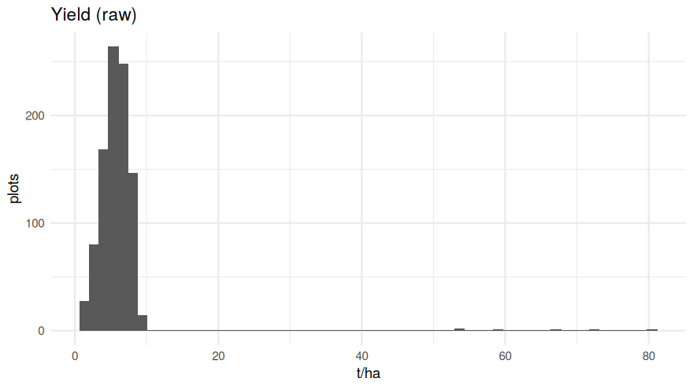
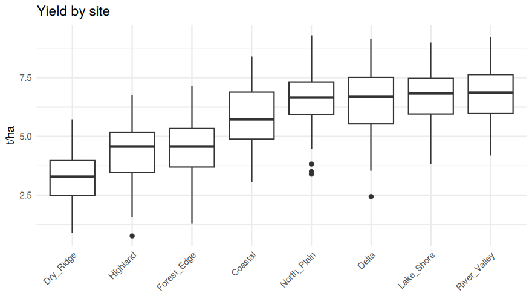
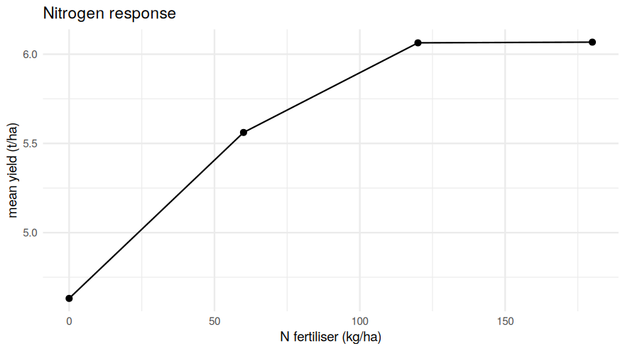
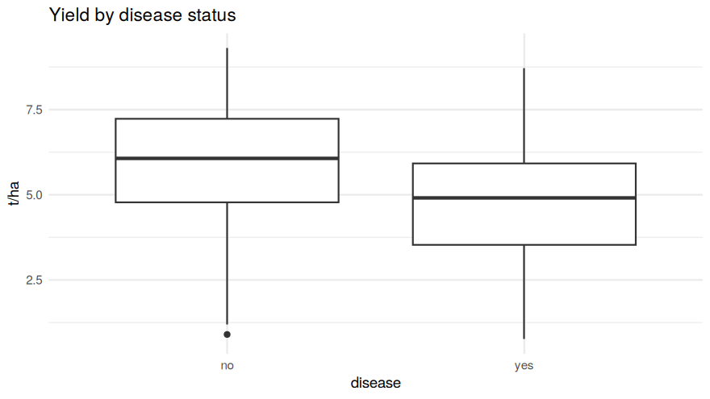
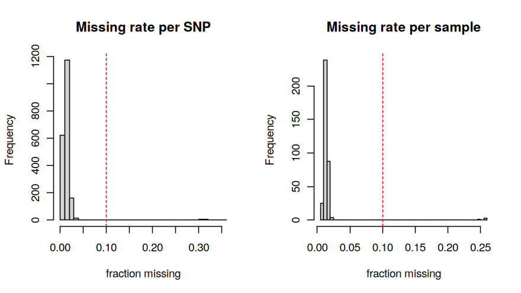
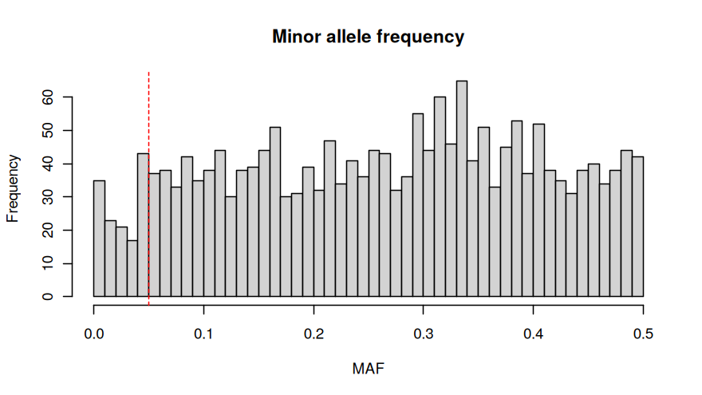
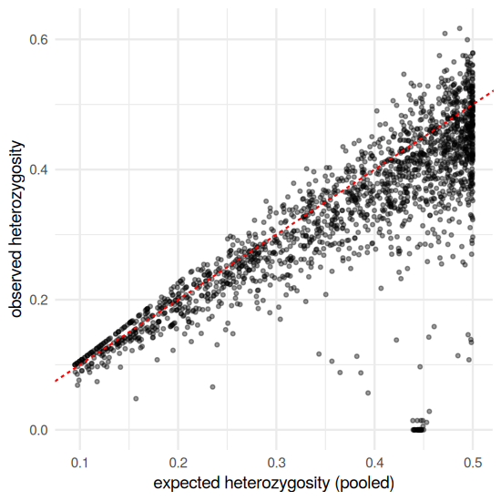
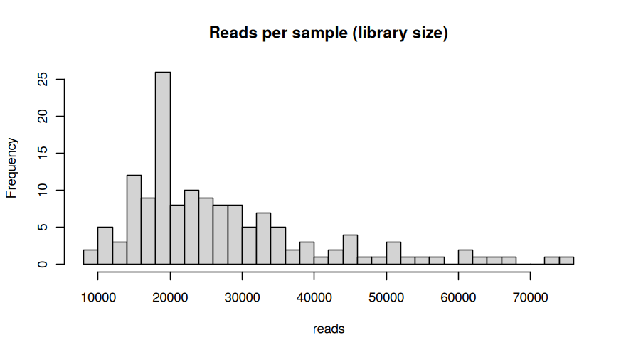
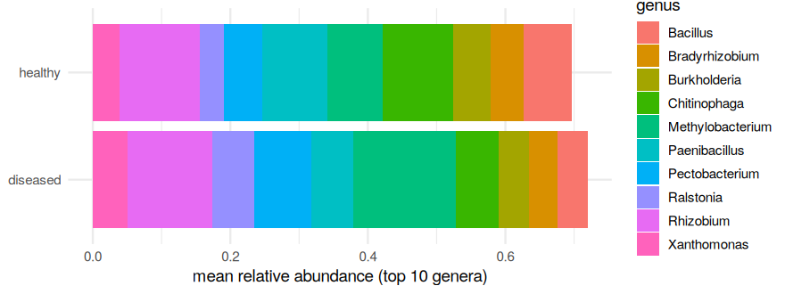

Every AI project starts with looking hard at the data. In this lab you explore
three typical datasets and find the problems hiding in each:

- **Part A — Field trials:** missing values, typos and outliers in agronomic data
- **Part B — Population genetics:** quality control of a SNP genotype matrix
- **Part C — Metagenomics:** why raw microbiome counts can't be compared directly

All datasets are simulated to look like real data, problems included.

```r
pkgs <- c("ggplot2")
new <- setdiff(pkgs, rownames(installed.packages()))
if (length(new)) install.packages(new)

library(ggplot2)
options(repr.plot.width = 8, repr.plot.height = 4.5, repr.plot.res = 110)
theme_set(theme_minimal(base_size = 12))

REPO <- "YOUR-GITHUB-USERNAME/ai-for-agri-bio"

# Use the local data folder if it exists, otherwise download from GitHub
data_path <- function(name) {
  for (folder in c("data", "../data", "../../data")) {
    f <- file.path(folder, name)
    if (file.exists(f)) return(f)
  }
  paste0("https://raw.githubusercontent.com/", REPO, "/main/data/", name)
}
```

### Part A — Field trials

Each row is one plot in a multi-site variety trial: where and when it was grown,
the variety, fertiliser, soil and weather measurements, whether disease was
scored, and the yield.

```r
trials <- read.csv(data_path("crop_trials.csv"))
dim(trials)
head(trials)
```

::: {.lab-table}
1. 961
2. 14
:::

::: {.lab-table}
| <!--/--> | plot_id | site | year | variety | n_fert_kg_ha | soil_p_mg_kg | soil_k_mg_kg | soil_ph | organic_matter_pct | rainfall_mm | mean_temp_c | irrigated | disease | yield_t_ha |
|---|---|---|---|---|---|---|---|---|---|---|---|---|---|---|
| 1 | P0001 | North_Plain | 2021 | V01 |   0 | 23.8 | 186 | 6.49 | 3.39 | 508 | 14.4 | 0 | 0 | 5.13 |
| 2 | P0002 | North_Plain | 2021 | V01 |  60 | 15.6 | 214 | 6.77 | 2.80 | 508 | 14.4 | 0 | 0 | 7.01 |
| 3 | P0003 | North_Plain | 2021 | V01 | 120 | 21.3 | 180 | 6.63 | 2.83 | 508 | 14.4 | 0 | 0 | 6.82 |
| 4 | P0004 | North_Plain | 2021 | V01 | 180 | 29.8 | 189 | 6.48 | 3.61 | 508 | 14.4 | 0 | 0 | 9.31 |
| 5 | P0005 | North_Plain | 2021 | V02 |   0 | 31.6 | 133 | 6.53 | 2.90 | 508 | 14.4 | 0 | 1 | 4.78 |
| 6 | P0006 | North_Plain | 2021 | V02 |  60 | 35.3 | 138 | 6.45 | 1.71 | 508 | 14.4 | 0 | 0 | 6.33 |
:::

**How much is missing?** Count missing values per column.

```r
colSums(is.na(trials))
```

::: {.lab-table}
plot_id
:   0site
:   0year
:   0variety
:   0n_fert_kg_ha
:   0soil_p_mg_kg
:   48soil_k_mg_kg
:   19soil_ph
:   0organic_matter_pct
:   38rainfall_mm
:   0mean_temp_c
:   0irrigated
:   0disease
:   0yield_t_ha
:   8
:::

**Do the values make sense?** Summary statistics catch impossible values fast.
Look at the minimum and maximum of each column.

```r
summary(trials[, c("n_fert_kg_ha", "soil_p_mg_kg", "soil_ph", "rainfall_mm", "yield_t_ha")])
```

```{.text .lab-output}
  n_fert_kg_ha     soil_p_mg_kg      soil_ph       rainfall_mm   
 Min.   :  0.00   Min.   : 5.00   Min.   :0.000   Min.   :255.0  
 1st Qu.: 60.00   1st Qu.:19.70   1st Qu.:6.050   1st Qu.:452.0  
 Median :120.00   Median :25.20   Median :6.750   Median :563.0  
 Mean   : 91.28   Mean   :24.84   Mean   :6.561   Mean   :545.1  
 3rd Qu.:180.00   3rd Qu.:30.20   3rd Qu.:7.110   3rd Qu.:637.0  
 Max.   :180.00   Max.   :51.70   Max.   :8.140   Max.   :781.0  
                  NA's   :48                                     
   yield_t_ha    
 Min.   : 0.760  
 1st Qu.: 4.460  
 Median : 5.720  
 Mean   : 5.963  
 3rd Qu.: 6.930  
 Max.   :79.900  
 NA's   :8       
```

A yield of over 60 t/ha is impossible for a cereal, and a soil pH of 0 is a
broken sensor. A histogram shows how rare these values are.

```r
ggplot(trials, aes(yield_t_ha)) +
  geom_histogram(bins = 60) +
  labs(title = "Yield (raw)", x = "t/ha", y = "plots")
```

{.lab-figure}

**Clean, and write down every decision.** Here we treat impossible values as
missing, then drop plots with no yield. In a real project, you would check the
field book first: 66.5 might really be 6.65.

```r
clean <- trials
clean$yield_t_ha[clean$yield_t_ha > 20] <- NA
clean$soil_ph[clean$soil_ph < 3] <- NA
clean <- clean[!is.na(clean$yield_t_ha), ]
cat(nrow(trials) - nrow(clean), "plots removed,", nrow(clean), "remain\n")
```

```{.text .lab-output}
14 plots removed, 947 remain
```

**Explore relationships.** Yield differs a lot between sites — remember this,
it becomes important in Lab 04.

```r
ggplot(clean, aes(reorder(site, yield_t_ha, FUN = median), yield_t_ha)) +
  geom_boxplot() +
  labs(title = "Yield by site", x = NULL, y = "t/ha") +
  theme(axis.text.x = element_text(angle = 45, hjust = 1))
```

{.lab-figure}

```r
n_means <- aggregate(yield_t_ha ~ n_fert_kg_ha, data = clean, FUN = mean)
ggplot(n_means, aes(n_fert_kg_ha, yield_t_ha)) +
  geom_line() + geom_point(size = 2) +
  labs(title = "Nitrogen response", x = "N fertiliser (kg/ha)", y = "mean yield (t/ha)")
```

{.lab-figure}

```r
ggplot(clean, aes(factor(disease, labels = c("no", "yes")), yield_t_ha)) +
  geom_boxplot() +
  labs(title = "Yield by disease status", x = "disease", y = "t/ha")
```

{.lab-figure}

**Try it:** Which variety has the highest mean yield? Is it the same at every site?
(Hint: `tapply(clean$yield_t_ha, list(clean$variety, clean$site), mean)`.)

### Part B — Population genetics: genotype quality control

The genotype matrix has one row per plant and one column per SNP. Each value
counts copies of the alternative allele: **0** = homozygous reference,
**1** = heterozygous, **2** = homozygous alternative. The plants come from three
landraces, each made up of families of full siblings.

```r
geno <- as.matrix(read.csv(data_path("genotypes.csv"), row.names = "sample_id"))
samples <- read.csv(data_path("genotype_samples.csv"), row.names = "sample_id")
dim(geno)
geno[1:5, 1:6]
```

::: {.lab-table}
1. 360
2. 2000
:::

::: {.lab-table}
| <!--/--> | snp_1_80637 | snp_1_487938 | snp_1_559022 | snp_1_563769 | snp_1_918668 | snp_1_1040277 |
|---|---|---|---|---|---|---|
| S001 | 2 | 0 | 1 | 0 | 1 | 2 |
| S002 | 2 | 0 | 1 | 0 | 1 | 2 |
| S003 | 2 | 0 | 1 | 1 | 1 | 2 |
| S004 | 2 | 0 | 1 | 0 | 1 | 2 |
| S005 | 2 | 0 | 1 | 0 | 2 | 2 |
:::

```r
table(samples$population)
```

```{.text .lab-output}

 Coastal Highland   Valley 
     120      120      120 
```

**Call rate.** Missing calls cluster in bad SNPs and bad DNA samples. Remove
SNPs and samples with more than 10% missing data.

```r
snp_missing <- colMeans(is.na(geno))
sample_missing <- rowMeans(is.na(geno))

par(mfrow = c(1, 2))
hist(snp_missing, breaks = 50, main = "Missing rate per SNP", xlab = "fraction missing")
abline(v = 0.1, col = "red", lty = 2)
hist(sample_missing, breaks = 50, main = "Missing rate per sample", xlab = "fraction missing")
abline(v = 0.1, col = "red", lty = 2)
par(mfrow = c(1, 1))
```

{.lab-figure}

```r
geno_qc <- geno[sample_missing <= 0.1, snp_missing <= 0.1]
cat("Removed", sum(sample_missing > 0.1), "samples and", sum(snp_missing > 0.1), "SNPs\n")
```

```{.text .lab-output}
Removed 4 samples and 25 SNPs
```

**Minor allele frequency (MAF).** SNPs where almost every plant has the same
genotype carry no information for most analyses.

```r
p_alt <- colMeans(geno_qc, na.rm = TRUE) / 2
maf <- pmin(p_alt, 1 - p_alt)
hist(maf, breaks = 50, main = "Minor allele frequency", xlab = "MAF")
abline(v = 0.05, col = "red", lty = 2)
geno_qc <- geno_qc[, maf >= 0.05]
cat(ncol(geno_qc), "SNPs pass the MAF filter\n")
```

```{.text .lab-output}
1839 SNPs pass the MAF filter
```

{.lab-figure}

**Hardy–Weinberg equilibrium (HWE).** Under random mating, a SNP with allele
frequency p should have about 2p(1−p) heterozygotes. Too few heterozygotes can
mean genotyping errors — but it can also mean **population structure**: pooling
separate populations creates a heterozygote deficit (the *Wahlund effect*).
We test each SNP in the pooled data and within each landrace.

```r
# Chi-square HWE test (1 df) for every SNP column of a 0/1/2 matrix
hwe_pvalues <- function(g) {
  n0 <- colSums(g == 0, na.rm = TRUE)
  n1 <- colSums(g == 1, na.rm = TRUE)
  n2 <- colSums(g == 2, na.rm = TRUE)
  n <- n0 + n1 + n2
  p <- (n1 + 2 * n2) / (2 * n)
  e0 <- n * (1 - p)^2; e1 <- 2 * n * p * (1 - p); e2 <- n * p^2
  chi <- (n0 - e0)^2 / e0 + (n1 - e1)^2 / e1 + (n2 - e2)^2 / e2
  pchisq(chi, df = 1, lower.tail = FALSE)
}

pooled <- hwe_pvalues(geno_qc)
pops <- samples[rownames(geno_qc), "population"]
within <- sapply(unique(pops), function(pop) hwe_pvalues(geno_qc[pops == pop, ]))

threshold <- 1e-6
n_fail <- rowSums(within < threshold, na.rm = TRUE)  # NA = SNP monomorphic in that landrace
cat("SNPs failing HWE in the pooled data:", sum(pooled < threshold, na.rm = TRUE), "\n")
cat("Number of landraces in which a SNP fails HWE:\n")
table(n_fail)
```

```{.text .lab-output}
SNPs failing HWE in the pooled data: 166 
```

```{.text .lab-output}
Number of landraces in which a SNP fails HWE:
```

```{.text .lab-output}
n_fail
   0    1    2    3 
1792   33    1   13 
```

Pooled, many SNPs "fail" HWE because of population structure, not bad
genotyping. Testing within populations finds the SNPs that are really broken.
Observed versus expected heterozygosity shows the same thing:

```r
p <- colMeans(geno_qc, na.rm = TRUE) / 2
het <- data.frame(expected = 2 * p * (1 - p),
                  observed = colSums(geno_qc == 1, na.rm = TRUE) / colSums(!is.na(geno_qc)))
options(repr.plot.width = 5, repr.plot.height = 5)
ggplot(het, aes(expected, observed)) +
  geom_point(alpha = 0.4, size = 0.8) +
  geom_abline(colour = "red", linetype = 2) +
  labs(x = "expected heterozygosity (pooled)", y = "observed heterozygosity")
options(repr.plot.width = 8, repr.plot.height = 4.5)
```

{.lab-figure}

```r
# Families of siblings can push single SNPs out of HWE by chance, so we only
# remove SNPs that fail in at least two of the three landraces.
geno_qc <- geno_qc[, n_fail < 2]
cat("Final genotype matrix:", nrow(geno_qc), "samples x", ncol(geno_qc), "SNPs\n")
```

```{.text .lab-output}
Final genotype matrix: 356 samples x 1825 SNPs
```

**Try it:** Change the MAF threshold to 0.01 and 0.10. How many SNPs remain?

### Part C — Metagenomics: microbiome count tables

Amplicon sequencing (e.g. 16S rRNA) gives a table of read counts: one row per
soil sample, one column per ASV (amplicon sequence variant, roughly a bacterial
taxon). Samples come from healthy and diseased fields.

```r
counts <- as.matrix(read.csv(data_path("microbiome_counts.csv"), row.names = "sample_id"))
meta <- read.csv(data_path("microbiome_metadata.csv"), row.names = "sample_id")
taxonomy <- read.csv(data_path("microbiome_taxonomy.csv"), row.names = "taxon_id")
dim(counts)
counts[1:5, 1:6]
```

::: {.lab-table}
1. 144
2. 200
:::

::: {.lab-table}
| <!--/--> | ASV001 | ASV002 | ASV003 | ASV004 | ASV005 | ASV006 |
|---|---|---|---|---|---|---|
| M001 |  8 | 1 |  4 |  0 |  59 |  256 |
| M002 | 13 | 1 | 35 | 10 |   3 |   21 |
| M003 | 14 | 3 |  0 |  3 | 119 | 1141 |
| M004 |  2 | 7 | 41 | 35 |  10 |   54 |
| M005 | 11 | 5 |  1 |  3 |  60 | 1787 |
:::

**Library size.** The total number of reads per sample is set by the sequencer,
not by the soil. A sample with 60,000 reads is not "more bacterial" than one
with 10,000.

```r
depth <- rowSums(counts)
hist(depth, breaks = 30, main = "Reads per sample (library size)", xlab = "reads")
cat("Smallest library:", min(depth), "reads; largest:", max(depth), "reads\n")
cat("Zeros in the table:", round(100 * mean(counts == 0)), "%\n")
```

```{.text .lab-output}
Smallest library: 8997 reads; largest: 75453 reads
```

```{.text .lab-output}
Zeros in the table: 8 %
```

{.lab-figure}

**Relative abundance** makes samples comparable by dividing by library size.
Here we sum ASVs to genus level and compare the top 10 genera between healthy
and diseased fields.

```r
rel <- counts / depth
genus <- t(rowsum(t(rel), taxonomy[colnames(rel), "genus"]))
top <- names(sort(colMeans(genus), decreasing = TRUE))[1:10]
by_status <- aggregate(genus[, top], by = list(status = meta[rownames(genus), "soil_status"]), FUN = mean)
long <- data.frame(status = rep(by_status$status, times = length(top)),
                   genus = rep(top, each = nrow(by_status)),
                   abundance = unlist(by_status[, top]))
options(repr.plot.height = 3)
ggplot(long, aes(abundance, status, fill = genus)) +
  geom_col() +
  labs(x = "mean relative abundance (top 10 genera)", y = NULL)
options(repr.plot.height = 4.5)
```

{.lab-figure}

**Compositional data.** Relative abundances sum to 1, so if one taxon goes up,
the others must go down — even if their real numbers didn't change. The
**centred log-ratio (CLR)** transform is a standard fix before machine learning:
take logs (with a small pseudocount for zeros) and subtract each sample's mean.

```r
clr <- function(x, pseudocount = 0.5) {
  logx <- log(x + pseudocount)
  logx - rowMeans(logx)
}
counts_clr <- clr(counts)
round(counts_clr[1:5, 1:6], 2)
```

::: {.lab-table}
| <!--/--> | ASV001 | ASV002 | ASV003 | ASV004 | ASV005 | ASV006 |
|---|---|---|---|---|---|---|
| M001 | -0.45 | -2.18 | -1.08 | -3.28 |  1.50 | 2.96 |
| M002 | -0.20 | -2.40 |  0.77 | -0.45 | -1.55 | 0.26 |
| M003 | -0.84 | -2.26 | -4.21 | -2.26 |  1.27 | 3.53 |
| M004 | -2.06 | -0.96 |  0.75 |  0.60 | -0.62 | 1.02 |
| M005 |  0.08 | -0.66 | -1.96 | -1.11 |  1.74 | 5.12 |
:::

**Try it:** Which genus differs most between healthy and diseased fields?
Compare the genus means by `meta$soil_status`, sorted by the difference.
Then check whether the same genera differ between **sequencing batches**
(`meta$seq_batch`). Keep your answer for Lab 04.
