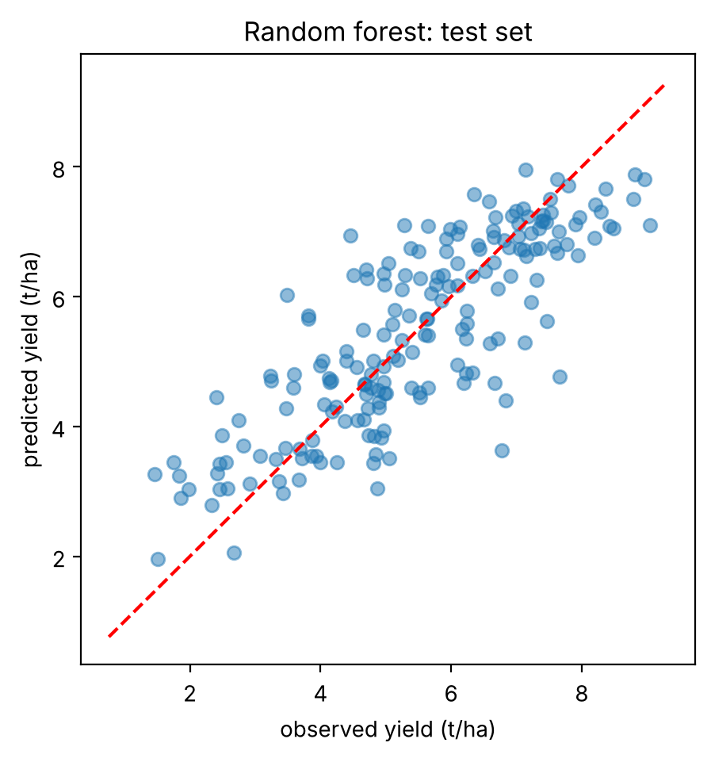
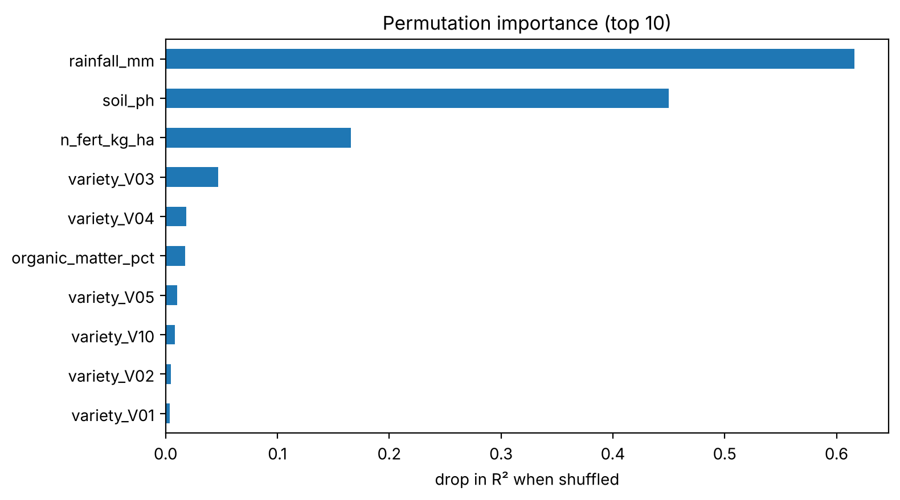
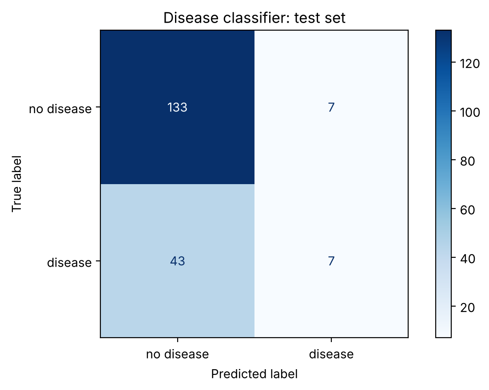
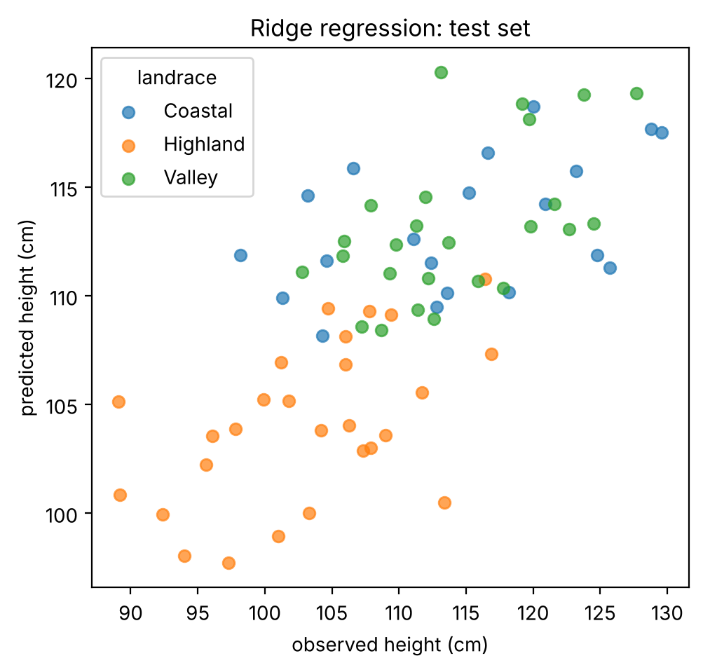
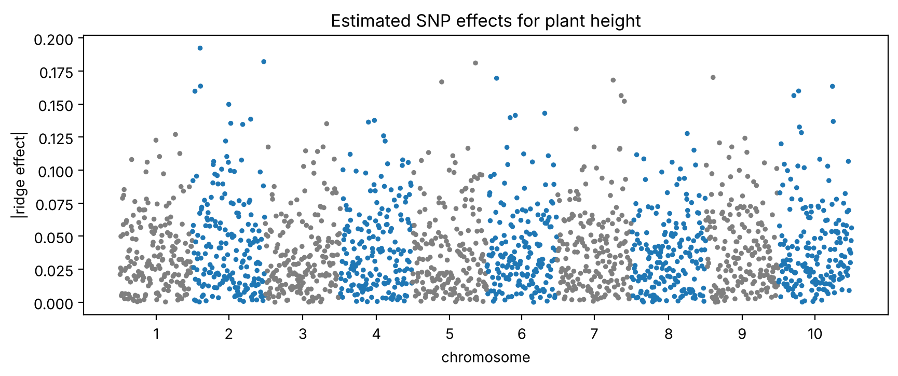
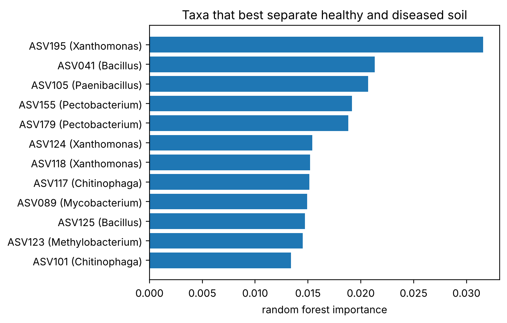

You will train models that learn from examples and make predictions on data
they have not seen:

- **Part A — Field trials:** predict yield (regression) and disease (classification)
- **Part B — Genomic prediction:** predict plant height from SNP genotypes
- **Part C — Metagenomics:** tell healthy from diseased soil by its microbiome

The workflow is always the same: split the data, train on one part, and
measure performance on the part the model never saw.

```python
import os

import numpy as np
import pandas as pd
import matplotlib.pyplot as plt
from sklearn.model_selection import train_test_split
from sklearn.ensemble import RandomForestRegressor, RandomForestClassifier
from sklearn.linear_model import LinearRegression, RidgeCV
from sklearn.inspection import permutation_importance
from sklearn.metrics import (mean_squared_error, r2_score, accuracy_score,
                             confusion_matrix, ConfusionMatrixDisplay, roc_auc_score)

REPO = "abu85/ai-for-agri-bio"


def data_path(name):
    """Use the local data folder if it exists, otherwise download from GitHub."""
    for folder in ["data", "../data", "../../data"]:
        if os.path.exists(os.path.join(folder, name)):
            return os.path.join(folder, name)
    return f"https://raw.githubusercontent.com/{REPO}/main/data/{name}"


plt.rcParams["figure.figsize"] = (8, 4.5)
SEED = 42
```

### Part A — Predicting yield and disease

First, the cleaning steps from Lab 02. Then we fill the remaining missing soil
values with the median, and turn the variety names into 0/1 columns
("one-hot encoding") because models need numbers.

```python
trials = pd.read_csv(data_path("crop_trials.csv"))
trials.loc[trials["yield_t_ha"] > 20, "yield_t_ha"] = np.nan
trials.loc[trials["soil_ph"] < 3, "soil_ph"] = np.nan
trials = trials.dropna(subset=["yield_t_ha"])

features = ["n_fert_kg_ha", "soil_p_mg_kg", "soil_k_mg_kg", "soil_ph", "organic_matter_pct",
            "rainfall_mm", "mean_temp_c", "irrigated", "variety"]
X = pd.get_dummies(trials[features], columns=["variety"], dtype=int)
X = X.fillna(X.median())
y = trials["yield_t_ha"]
X.head()
```

```{=html}
<div class="lab-table"><div>
<style scoped>
    .dataframe tbody tr th:only-of-type {
        vertical-align: middle;
    }

    .dataframe tbody tr th {
        vertical-align: top;
    }

    .dataframe thead th {
        text-align: right;
    }
</style>
<table border="1" class="dataframe">
  <thead>
    <tr style="text-align: right;">
      <th></th>
      <th>n_fert_kg_ha</th>
      <th>soil_p_mg_kg</th>
      <th>soil_k_mg_kg</th>
      <th>soil_ph</th>
      <th>organic_matter_pct</th>
      <th>rainfall_mm</th>
      <th>mean_temp_c</th>
      <th>irrigated</th>
      <th>variety_V01</th>
      <th>variety_V02</th>
      <th>variety_V03</th>
      <th>variety_V04</th>
      <th>variety_V05</th>
      <th>variety_V06</th>
      <th>variety_V07</th>
      <th>variety_V08</th>
      <th>variety_V09</th>
      <th>variety_V10</th>
    </tr>
  </thead>
  <tbody>
    <tr>
      <th>0</th>
      <td>0</td>
      <td>23.8</td>
      <td>186.0</td>
      <td>6.49</td>
      <td>3.39</td>
      <td>508.0</td>
      <td>14.4</td>
      <td>0</td>
      <td>1</td>
      <td>0</td>
      <td>0</td>
      <td>0</td>
      <td>0</td>
      <td>0</td>
      <td>0</td>
      <td>0</td>
      <td>0</td>
      <td>0</td>
    </tr>
    <tr>
      <th>1</th>
      <td>60</td>
      <td>15.6</td>
      <td>214.0</td>
      <td>6.77</td>
      <td>2.80</td>
      <td>508.0</td>
      <td>14.4</td>
      <td>0</td>
      <td>1</td>
      <td>0</td>
      <td>0</td>
      <td>0</td>
      <td>0</td>
      <td>0</td>
      <td>0</td>
      <td>0</td>
      <td>0</td>
      <td>0</td>
    </tr>
    <tr>
      <th>2</th>
      <td>120</td>
      <td>21.3</td>
      <td>180.0</td>
      <td>6.63</td>
      <td>2.83</td>
      <td>508.0</td>
      <td>14.4</td>
      <td>0</td>
      <td>1</td>
      <td>0</td>
      <td>0</td>
      <td>0</td>
      <td>0</td>
      <td>0</td>
      <td>0</td>
      <td>0</td>
      <td>0</td>
      <td>0</td>
    </tr>
    <tr>
      <th>3</th>
      <td>180</td>
      <td>29.8</td>
      <td>189.0</td>
      <td>6.48</td>
      <td>3.61</td>
      <td>508.0</td>
      <td>14.4</td>
      <td>0</td>
      <td>1</td>
      <td>0</td>
      <td>0</td>
      <td>0</td>
      <td>0</td>
      <td>0</td>
      <td>0</td>
      <td>0</td>
      <td>0</td>
      <td>0</td>
    </tr>
    <tr>
      <th>4</th>
      <td>0</td>
      <td>31.6</td>
      <td>133.0</td>
      <td>6.53</td>
      <td>2.90</td>
      <td>508.0</td>
      <td>14.4</td>
      <td>0</td>
      <td>0</td>
      <td>1</td>
      <td>0</td>
      <td>0</td>
      <td>0</td>
      <td>0</td>
      <td>0</td>
      <td>0</td>
      <td>0</td>
      <td>0</td>
    </tr>
  </tbody>
</table>
</div></div>
```

**Split** into 80% training and 20% test data. The test set is locked away
until the very end.

```python
X_train, X_test, y_train, y_test = train_test_split(X, y, test_size=0.2, random_state=SEED)
print(f"training plots: {len(X_train)}, test plots: {len(X_test)}")
```

```{.text .lab-output}
training plots: 757, test plots: 190
```

**Always compare with a baseline.** The simplest "model" predicts the average
training yield for every plot. Any real model must beat it.

```python
def rmse(true, pred):
    return np.sqrt(mean_squared_error(true, pred))


baseline = np.full(len(y_test), y_train.mean())
linear = LinearRegression().fit(X_train, y_train)
forest = RandomForestRegressor(n_estimators=500, random_state=SEED, n_jobs=-1).fit(X_train, y_train)

results = pd.DataFrame({
    "model": ["baseline (mean)", "linear regression", "random forest"],
    "RMSE (t/ha)": [rmse(y_test, p) for p in [baseline, linear.predict(X_test), forest.predict(X_test)]],
    "R2": [r2_score(y_test, p) for p in [baseline, linear.predict(X_test), forest.predict(X_test)]],
}).round(3)
results
```

```{=html}
<div class="lab-table"><div>
<style scoped>
    .dataframe tbody tr th:only-of-type {
        vertical-align: middle;
    }

    .dataframe tbody tr th {
        vertical-align: top;
    }

    .dataframe thead th {
        text-align: right;
    }
</style>
<table border="1" class="dataframe">
  <thead>
    <tr style="text-align: right;">
      <th></th>
      <th>model</th>
      <th>RMSE (t/ha)</th>
      <th>R2</th>
    </tr>
  </thead>
  <tbody>
    <tr>
      <th>0</th>
      <td>baseline (mean)</td>
      <td>1.715</td>
      <td>-0.011</td>
    </tr>
    <tr>
      <th>1</th>
      <td>linear regression</td>
      <td>1.559</td>
      <td>0.164</td>
    </tr>
    <tr>
      <th>2</th>
      <td>random forest</td>
      <td>0.991</td>
      <td>0.663</td>
    </tr>
  </tbody>
</table>
</div></div>
```

```python
pred = forest.predict(X_test)
plt.figure(figsize=(5, 5))
plt.scatter(y_test, pred, alpha=0.5)
lims = [y.min(), y.max()]
plt.plot(lims, lims, color="red", ls="--")
plt.xlabel("observed yield (t/ha)")
plt.ylabel("predicted yield (t/ha)")
plt.title("Random forest: test set")
plt.show()
```

{.lab-figure}

**What did the model learn?** Permutation importance shuffles one feature at a
time and measures how much worse the predictions get. Big drop = important.

```python
imp = permutation_importance(forest, X_test, y_test, n_repeats=10, random_state=SEED, n_jobs=-1)
importance = pd.Series(imp.importances_mean, index=X.columns).sort_values()
importance.tail(10).plot(kind="barh")
plt.xlabel("drop in R² when shuffled")
plt.title("Permutation importance (top 10)")
plt.tight_layout()
plt.show()
```

{.lab-figure}

Rainfall and temperature rank high. They are measured once per site and year, so
the model may partly be learning *which site* a plot is from. Lab 04 tests this.

**Classification: was the plot diseased?** Same recipe, different target.
Disease was scored on about a quarter of plots, so a model that always says
"healthy" already gets about 75% right — another reason to check the baseline.

```python
# Same features as before; yield itself is not used to predict disease
yd = trials["disease"]
Xd_train, Xd_test, yd_train, yd_test = train_test_split(X, yd, test_size=0.2, random_state=SEED, stratify=yd)

clf = RandomForestClassifier(n_estimators=500, random_state=SEED, n_jobs=-1).fit(Xd_train, yd_train)
prob = clf.predict_proba(Xd_test)[:, 1]
print(f"baseline accuracy (always 'no disease'): {1 - yd_test.mean():.2f}")
print(f"random forest accuracy:                  {accuracy_score(yd_test, clf.predict(Xd_test)):.2f}")
print(f"random forest ROC AUC:                   {roc_auc_score(yd_test, prob):.2f}")
```

```{.text .lab-output}
baseline accuracy (always 'no disease'): 0.74
random forest accuracy:                  0.74
random forest ROC AUC:                   0.68
```

The forest is about as *accurate* as always guessing "no disease". Yet its ROC
AUC is above 0.5, so it ranks diseased plots higher than healthy ones more often
than chance. Accuracy hides this when classes are unbalanced; the confusion
matrix shows where the errors are.

```python
ConfusionMatrixDisplay(confusion_matrix(yd_test, clf.predict(Xd_test)),
                       display_labels=["no disease", "disease"]).plot(cmap="Blues")
plt.title("Disease classifier: test set")
plt.show()
```

{.lab-figure}

**Try it:** Change `n_estimators` to 10 and 2000. Does the test performance
change much? Then try `max_depth=3`.

### Part B — Genomic prediction

Plant breeders predict a plant's breeding value from its DNA, so they can
select seedlings before they are grown out in the field. Here we predict
plant height from ~1,800 SNPs.

**Ridge regression** gives every SNP a small effect and shrinks them all
towards zero. It is the machine-learning twin of **rrBLUP/GBLUP**, the
workhorse of genomic selection. We compare it with a random forest.

```python
geno = pd.read_csv(data_path("genotypes.csv"), index_col="sample_id")
samples = pd.read_csv(data_path("genotype_samples.csv"), index_col="sample_id")

# QC from Lab 02 (short version): drop bad samples and SNPs, filter MAF
geno = geno.loc[geno.isna().mean(axis=1) <= 0.1, geno.isna().mean(axis=0) <= 0.1]
p = geno.mean() / 2
geno = geno.loc[:, np.minimum(p, 1 - p) >= 0.05]
geno = geno.fillna(geno.mean())  # mean imputation of missing calls
height = samples.loc[geno.index, "plant_height_cm"]
print(geno.shape)
```

```{.text .lab-output}
(356, 1839)
```

```python
G_train, G_test, h_train, h_test = train_test_split(geno, height, test_size=0.2, random_state=SEED)

ridge = RidgeCV(alphas=np.logspace(0, 5, 30)).fit(G_train, h_train)
rf_g = RandomForestRegressor(n_estimators=500, max_features=0.3, random_state=SEED, n_jobs=-1).fit(G_train, h_train)

for name, model in [("ridge (rrBLUP-like)", ridge), ("random forest", rf_g)]:
    pred = model.predict(G_test)
    r = np.corrcoef(h_test, pred)[0, 1]
    print(f"{name:20s} predictive ability r = {r:.2f}   RMSE = {rmse(h_test, pred):.1f} cm")
```

```{.text .lab-output}
ridge (rrBLUP-like)  predictive ability r = 0.71   RMSE = 6.7 cm
random forest        predictive ability r = 0.70   RMSE = 6.9 cm
```

In genomic selection, performance is usually reported as **predictive
ability**: the correlation between predicted and observed values in the test
set. Breeders care about ranking plants correctly more than exact centimetres.

```python
pred = ridge.predict(G_test)
pop = samples.loc[G_test.index, "population"]
plt.figure(figsize=(5.5, 5))
for name in pop.unique():
    m = pop == name
    plt.scatter(h_test[m], pred[m], label=name, alpha=0.7)
plt.xlabel("observed height (cm)")
plt.ylabel("predicted height (cm)")
plt.legend(title="landrace")
plt.title("Ridge regression: test set")
plt.show()
```

{.lab-figure}

Notice that the landraces form separate clouds. Part of the "prediction" may
simply be recognising which landrace a plant belongs to. Lab 04 measures how
much.

**Marker effects along the genome.** Plotting ridge coefficients by position
gives a Manhattan-style view of where height-related SNPs sit.

```python
info = pd.read_csv(data_path("snp_info.csv"), index_col="snp_id").loc[geno.columns]
effects = np.abs(ridge.coef_)
colors = np.where(info["chromosome"] % 2 == 0, "tab:blue", "tab:gray")
plt.figure(figsize=(10, 3.5))
plt.scatter(np.arange(len(effects)), effects, c=colors, s=6)
mids = info.reset_index().groupby("chromosome").apply(lambda d: d.index.values.mean(), include_groups=False)
plt.xticks(mids.values, mids.index)
plt.xlabel("chromosome")
plt.ylabel("|ridge effect|")
plt.title("Estimated SNP effects for plant height")
plt.show()
```

{.lab-figure}

**Try it:** Predict `flowering_days` instead of plant height. Which trait is
easier to predict, and why might that be?

### Part C — Metagenomics: classify soil health from the microbiome

Can the bacterial community tell us whether a field is healthy or diseased?
We use CLR-transformed counts (Lab 02) as features.

```python
counts = pd.read_csv(data_path("microbiome_counts.csv"), index_col="sample_id")
meta = pd.read_csv(data_path("microbiome_metadata.csv"), index_col="sample_id")
taxonomy = pd.read_csv(data_path("microbiome_taxonomy.csv"), index_col="taxon_id")

# Remove rare taxa (present in fewer than 10% of samples), then CLR-transform
counts = counts.loc[:, (counts > 0).mean() >= 0.1]
logx = np.log(counts + 0.5)
clr = logx.sub(logx.mean(axis=1), axis=0)
status = (meta.loc[clr.index, "soil_status"] == "diseased").astype(int)
print(clr.shape, "| diseased fraction:", status.mean().round(2))
```

```{.text .lab-output}
(144, 200) | diseased fraction: 0.5
```

```python
M_train, M_test, s_train, s_test = train_test_split(clr, status, test_size=0.25, random_state=SEED, stratify=status)
rf_m = RandomForestClassifier(n_estimators=500, random_state=SEED, n_jobs=-1).fit(M_train, s_train)
prob = rf_m.predict_proba(M_test)[:, 1]
print(f"accuracy: {accuracy_score(s_test, rf_m.predict(M_test)):.2f}")
print(f"ROC AUC:  {roc_auc_score(s_test, prob):.2f}")
```

```{.text .lab-output}
accuracy: 0.86
ROC AUC:  0.96
```

**Which taxa drive the prediction?** We label each ASV with its genus.

```python
imp = pd.Series(rf_m.feature_importances_, index=clr.columns).sort_values().tail(12)
labels = [f"{t} ({taxonomy.loc[t, 'genus']})" for t in imp.index]
plt.figure(figsize=(7, 4.5))
plt.barh(labels, imp.values)
plt.xlabel("random forest importance")
plt.title("Taxa that best separate healthy and diseased soil")
plt.tight_layout()
plt.show()
```

{.lab-figure}

Many top taxa make biological sense: plant pathogens such as *Xanthomonas*
and *Pectobacterium* in diseased soil, and genera with well-known biocontrol
members such as *Bacillus* and *Paenibacillus* in healthy soil. But
*Methylobacterium* and *Sphingomonas* — which may also turn up in the list —
are well-known **reagent contaminants** from DNA extraction kits. Why would they predict
soil health? Lab 04 investigates.

**Try it:** Train the same model on relative abundances instead of CLR values.
Does performance change?
