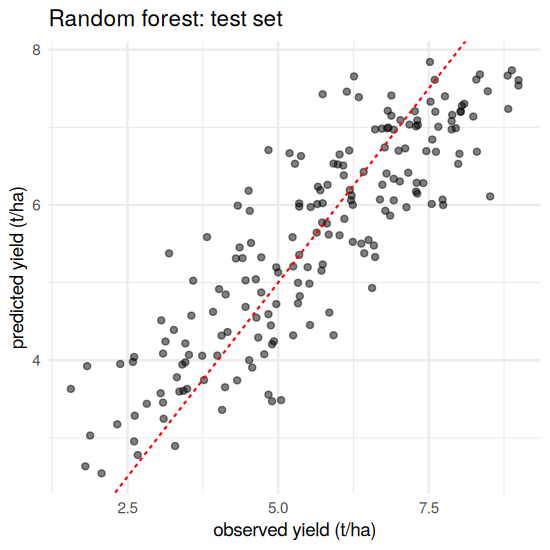
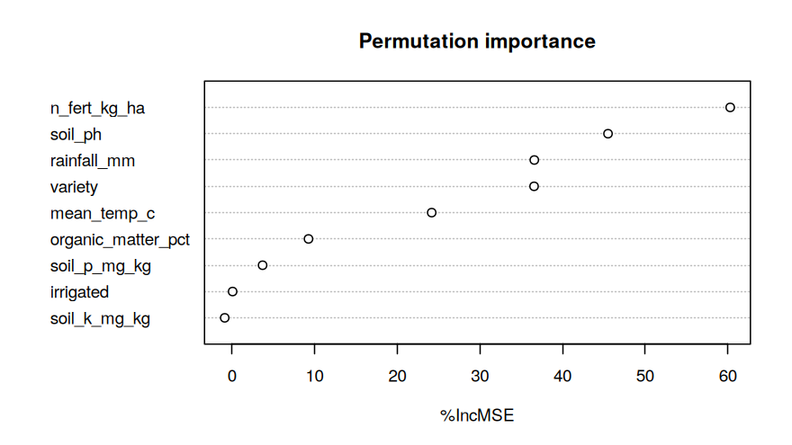
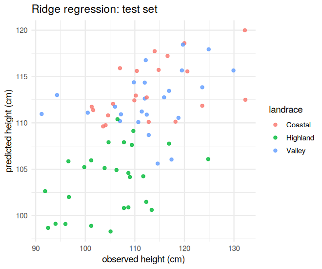
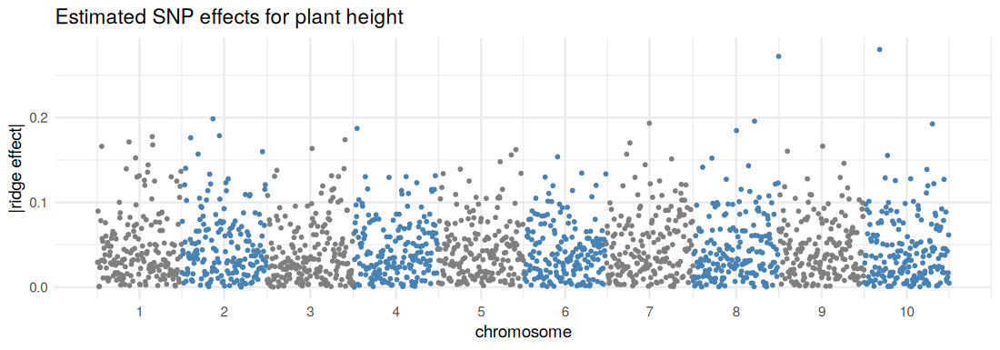
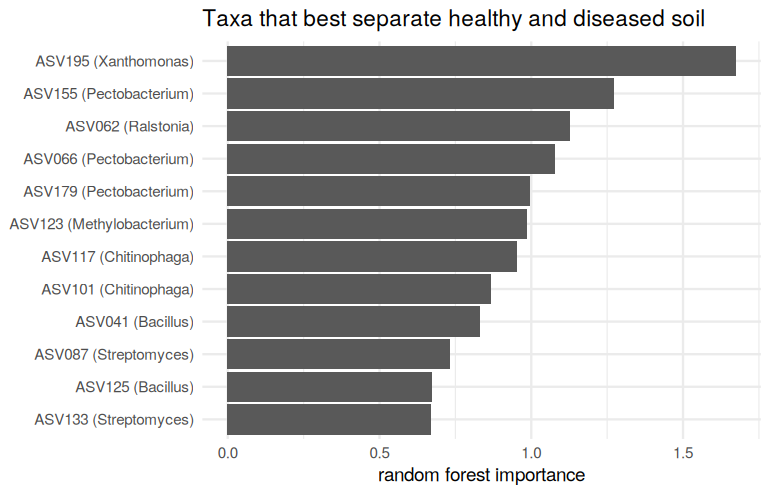

You will train models that learn from examples and make predictions on data
they have not seen:

- **Part A — Field trials:** predict yield (regression) and disease (classification)
- **Part B — Genomic prediction:** predict plant height from SNP genotypes
- **Part C — Metagenomics:** tell healthy from diseased soil by its microbiome

The workflow is always the same: split the data, train on one part, and
measure performance on the part the model never saw.

```r
pkgs <- c("ggplot2", "randomForest", "glmnet")
new <- setdiff(pkgs, rownames(installed.packages()))
if (length(new)) install.packages(new)

library(ggplot2)
library(randomForest)
library(glmnet)
options(repr.plot.width = 8, repr.plot.height = 4.5, repr.plot.res = 110)
theme_set(theme_minimal(base_size = 12))

REPO <- "YOUR-GITHUB-USERNAME/ai-for-agri-bio"
data_path <- function(name) {
  for (folder in c("data", "../data", "../../data")) {
    f <- file.path(folder, name)
    if (file.exists(f)) return(f)
  }
  paste0("https://raw.githubusercontent.com/", REPO, "/main/data/", name)
}

rmse <- function(obs, pred) sqrt(mean((obs - pred)^2))
r2 <- function(obs, pred) 1 - sum((obs - pred)^2) / sum((obs - mean(obs))^2)
# ROC AUC: probability that a random positive gets a higher score than a random negative
auc <- function(labels, scores) {
  r <- rank(scores); n1 <- sum(labels == 1); n0 <- sum(labels == 0)
  (sum(r[labels == 1]) - n1 * (n1 + 1) / 2) / (n1 * n0)
}
set.seed(42)
```

### Part A — Predicting yield and disease

First, the cleaning steps from Lab 02. Then we fill the remaining missing soil
values with the median. Variety stays a factor: R's random forest handles
categories directly.

```r
trials <- read.csv(data_path("crop_trials.csv"))
trials$yield_t_ha[trials$yield_t_ha > 20] <- NA
trials$soil_ph[trials$soil_ph < 3] <- NA
trials <- trials[!is.na(trials$yield_t_ha), ]

features <- c("n_fert_kg_ha", "soil_p_mg_kg", "soil_k_mg_kg", "soil_ph", "organic_matter_pct",
              "rainfall_mm", "mean_temp_c", "irrigated", "variety")
X <- trials[, features]
for (col in names(X)) if (is.numeric(X[[col]])) X[[col]][is.na(X[[col]])] <- median(X[[col]], na.rm = TRUE)
X$variety <- factor(X$variety)
y <- trials$yield_t_ha
head(X)
```

::: {.lab-table}
| <!--/--> | n_fert_kg_ha | soil_p_mg_kg | soil_k_mg_kg | soil_ph | organic_matter_pct | rainfall_mm | mean_temp_c | irrigated | variety |
|---|---|---|---|---|---|---|---|---|---|
| 1 |   0 | 23.8 | 186 | 6.49 | 3.39 | 508 | 14.4 | 0 | V01 |
| 2 |  60 | 15.6 | 214 | 6.77 | 2.80 | 508 | 14.4 | 0 | V01 |
| 3 | 120 | 21.3 | 180 | 6.63 | 2.83 | 508 | 14.4 | 0 | V01 |
| 4 | 180 | 29.8 | 189 | 6.48 | 3.61 | 508 | 14.4 | 0 | V01 |
| 5 |   0 | 31.6 | 133 | 6.53 | 2.90 | 508 | 14.4 | 0 | V02 |
| 6 |  60 | 35.3 | 138 | 6.45 | 1.71 | 508 | 14.4 | 0 | V02 |
:::

**Split** into 80% training and 20% test data. The test set is locked away
until the very end.

```r
test_idx <- sample(nrow(X), round(0.2 * nrow(X)))
X_train <- X[-test_idx, ]; X_test <- X[test_idx, ]
y_train <- y[-test_idx];   y_test <- y[test_idx]
cat("training plots:", nrow(X_train), " test plots:", nrow(X_test), "\n")
```

```{.text .lab-output}
training plots: 758  test plots: 189 
```

**Always compare with a baseline.** The simplest "model" predicts the average
training yield for every plot. Any real model must beat it.

```r
baseline <- rep(mean(y_train), length(y_test))
linear <- lm(y ~ ., data = cbind(X_train, y = y_train))
forest <- randomForest(X_train, y_train, ntree = 500, importance = TRUE)

preds <- list("baseline (mean)" = baseline,
              "linear regression" = predict(linear, X_test),
              "random forest" = predict(forest, X_test))
data.frame(model = names(preds),
           RMSE_t_ha = sapply(preds, function(p) round(rmse(y_test, p), 3)),
           R2 = sapply(preds, function(p) round(r2(y_test, p), 3)),
           row.names = NULL)
```

::: {.lab-table}
| model | RMSE_t_ha | R2 |
|---|---|---|
| baseline (mean)   | 1.753 | -0.001 |
| linear regression | 1.613 |  0.152 |
| random forest     | 0.899 |  0.737 |
:::

```r
options(repr.plot.width = 5, repr.plot.height = 5)
ggplot(data.frame(observed = y_test, predicted = preds[["random forest"]]), aes(observed, predicted)) +
  geom_point(alpha = 0.5) +
  geom_abline(colour = "red", linetype = 2) +
  labs(title = "Random forest: test set", x = "observed yield (t/ha)", y = "predicted yield (t/ha)")
options(repr.plot.width = 8, repr.plot.height = 4.5)
```

{.lab-figure}

**What did the model learn?** Permutation importance shuffles one feature at a
time and measures how much worse the predictions get. `randomForest` computes it
on the out-of-bag samples (`%IncMSE`). Big increase = important.

```r
varImpPlot(forest, type = 1, main = "Permutation importance")
```

{.lab-figure}

Rainfall and temperature rank high. They are measured once per site and year, so
the model may partly be learning *which site* a plot is from. Lab 04 tests this.

**Classification: was the plot diseased?** Same recipe, different target.
Disease was scored on about a quarter of plots, so a model that always says
"healthy" already gets about 75% right — another reason to check the baseline.

```r
yd <- factor(trials$disease, labels = c("no", "yes"))
clf <- randomForest(X_train, yd[-test_idx], ntree = 500)
prob <- predict(clf, X_test, type = "prob")[, "yes"]
pred_class <- predict(clf, X_test)
truth <- yd[test_idx]
cat("baseline accuracy (always 'no disease'):", round(mean(truth == "no"), 2), "\n")
cat("random forest accuracy:                 ", round(mean(pred_class == truth), 2), "\n")
cat("random forest ROC AUC:                  ", round(auc(as.integer(truth == "yes"), prob), 2), "\n")
```

```{.text .lab-output}
baseline accuracy (always 'no disease'): 0.71 
```

```{.text .lab-output}
random forest accuracy:                  0.7 
```

```{.text .lab-output}
random forest ROC AUC:                   0.64 
```

The forest is about as *accurate* as always guessing "no disease". Yet its
ROC AUC is above 0.5, so it ranks diseased plots higher than healthy ones more
often than chance. Accuracy hides this when classes are unbalanced; the
confusion matrix shows where the errors are.

```r
table(predicted = pred_class, observed = truth)
```

```{.text .lab-output}
         observed
predicted  no yes
      no  124  46
      yes  11   8
```

**Try it:** Change `ntree` to 10 and 2000. Does the test performance change
much? Then try `maxnodes = 8`.

### Part B — Genomic prediction

Plant breeders predict a plant's breeding value from its DNA, so they can
select seedlings before they are grown out in the field. Here we predict
plant height from ~1,800 SNPs.

**Ridge regression** gives every SNP a small effect and shrinks them all
towards zero. It is the machine-learning twin of **rrBLUP/GBLUP**, the
workhorse of genomic selection. We fit it with `glmnet` (`alpha = 0`) and
compare it with a random forest.

```r
geno <- as.matrix(read.csv(data_path("genotypes.csv"), row.names = "sample_id"))
samples <- read.csv(data_path("genotype_samples.csv"), row.names = "sample_id")

# QC from Lab 02 (short version): drop bad samples and SNPs, filter MAF
geno <- geno[rowMeans(is.na(geno)) <= 0.1, colMeans(is.na(geno)) <= 0.1]
p <- colMeans(geno, na.rm = TRUE) / 2
geno <- geno[, pmin(p, 1 - p) >= 0.05]
# mean imputation of missing calls
col_means <- colMeans(geno, na.rm = TRUE)
na_idx <- which(is.na(geno), arr.ind = TRUE)
geno[na_idx] <- col_means[na_idx[, 2]]
height <- samples[rownames(geno), "plant_height_cm"]
dim(geno)
```

::: {.lab-table}
1. 356
2. 1839
:::

```r
test_g <- sample(nrow(geno), round(0.2 * nrow(geno)))
ridge <- cv.glmnet(geno[-test_g, ], height[-test_g], alpha = 0)
rf_g <- randomForest(geno[-test_g, ], height[-test_g], ntree = 500, mtry = round(0.3 * ncol(geno)))

for (m in c("ridge", "random forest")) {
  pred <- if (m == "ridge") as.numeric(predict(ridge, geno[test_g, ], s = "lambda.min")) else predict(rf_g, geno[test_g, ])
  cat(sprintf("%-15s predictive ability r = %.2f   RMSE = %.1f cm\n",
              m, cor(height[test_g], pred), rmse(height[test_g], pred)))
}
```

```{.text .lab-output}
ridge           predictive ability r = 0.54   RMSE = 7.8 cm
random forest   predictive ability r = 0.52   RMSE = 7.9 cm
```

In genomic selection, performance is usually reported as **predictive
ability**: the correlation between predicted and observed values in the test
set. Breeders care about ranking plants correctly more than exact centimetres.

```r
gp <- data.frame(observed = height[test_g],
                 predicted = as.numeric(predict(ridge, geno[test_g, ], s = "lambda.min")),
                 landrace = samples[rownames(geno)[test_g], "population"])
options(repr.plot.width = 6, repr.plot.height = 5)
ggplot(gp, aes(observed, predicted, colour = landrace)) +
  geom_point(alpha = 0.8) +
  labs(title = "Ridge regression: test set", x = "observed height (cm)", y = "predicted height (cm)")
options(repr.plot.width = 8, repr.plot.height = 4.5)
```

{.lab-figure}

Notice that the landraces form separate clouds. Part of the "prediction" may
simply be recognising which landrace a plant belongs to. Lab 04 measures how
much.

**Marker effects along the genome.** Plotting ridge coefficients by position
gives a Manhattan-style view of where height-related SNPs sit.

```r
info <- read.csv(data_path("snp_info.csv"), row.names = "snp_id")[colnames(geno), ]
eff <- data.frame(index = seq_len(ncol(geno)),
                  effect = abs(as.numeric(coef(ridge, s = "lambda.min"))[-1]),
                  chromosome = factor(info$chromosome))
options(repr.plot.width = 10, repr.plot.height = 3.5)
ggplot(eff, aes(index, effect, colour = as.integer(chromosome) %% 2 == 0)) +
  geom_point(size = 0.7, show.legend = FALSE) +
  scale_colour_manual(values = c("grey50", "steelblue")) +
  scale_x_continuous(breaks = tapply(eff$index, eff$chromosome, mean), labels = levels(eff$chromosome)) +
  labs(title = "Estimated SNP effects for plant height", x = "chromosome", y = "|ridge effect|")
options(repr.plot.width = 8, repr.plot.height = 4.5)
```

{.lab-figure}

**Try it:** Predict `flowering_days` instead of plant height. Which trait is
easier to predict, and why might that be?

### Part C — Metagenomics: classify soil health from the microbiome

Can the bacterial community tell us whether a field is healthy or diseased?
We use CLR-transformed counts (Lab 02) as features.

```r
counts <- as.matrix(read.csv(data_path("microbiome_counts.csv"), row.names = "sample_id"))
meta <- read.csv(data_path("microbiome_metadata.csv"), row.names = "sample_id")
taxonomy <- read.csv(data_path("microbiome_taxonomy.csv"), row.names = "taxon_id")

# Remove rare taxa (present in fewer than 10% of samples), then CLR-transform
counts <- counts[, colMeans(counts > 0) >= 0.1]
logx <- log(counts + 0.5)
clr <- logx - rowMeans(logx)
status <- factor(meta[rownames(clr), "soil_status"], levels = c("healthy", "diseased"))
dim(clr)
table(status)
```

::: {.lab-table}
1. 144
2. 200
:::

```{.text .lab-output}
status
 healthy diseased 
      72       72 
```

```r
test_m <- c(sample(which(status == "healthy"), 18), sample(which(status == "diseased"), 18))
rf_m <- randomForest(clr[-test_m, ], status[-test_m], ntree = 500)
prob <- predict(rf_m, clr[test_m, ], type = "prob")[, "diseased"]
cat("accuracy:", round(mean(predict(rf_m, clr[test_m, ]) == status[test_m]), 2), "\n")
cat("ROC AUC: ", round(auc(as.integer(status[test_m] == "diseased"), prob), 2), "\n")
```

```{.text .lab-output}
accuracy: 0.89 
```

```{.text .lab-output}
ROC AUC:  0.97 
```

**Which taxa drive the prediction?** We label each ASV with its genus.

```r
imp <- sort(importance(rf_m)[, "MeanDecreaseGini"], decreasing = TRUE)[1:12]
imp_df <- data.frame(taxon = paste0(names(imp), " (", taxonomy[names(imp), "genus"], ")"), importance = imp)
options(repr.plot.width = 7, repr.plot.height = 4.5)
ggplot(imp_df, aes(importance, reorder(taxon, importance))) +
  geom_col() +
  labs(title = "Taxa that best separate healthy and diseased soil", x = "random forest importance", y = NULL)
options(repr.plot.width = 8, repr.plot.height = 4.5)
```

{.lab-figure}

Many top taxa make biological sense: plant pathogens such as *Xanthomonas*
and *Pectobacterium* in diseased soil, and genera with well-known biocontrol
members such as *Bacillus* and *Paenibacillus* in healthy soil. But
*Methylobacterium* and *Sphingomonas* — which may also turn up in the list —
are well-known **reagent contaminants** from DNA extraction kits. Why would they predict
soil health? Lab 04 investigates.

**Try it:** Train the same model on relative abundances instead of CLR values.
Does performance change?
