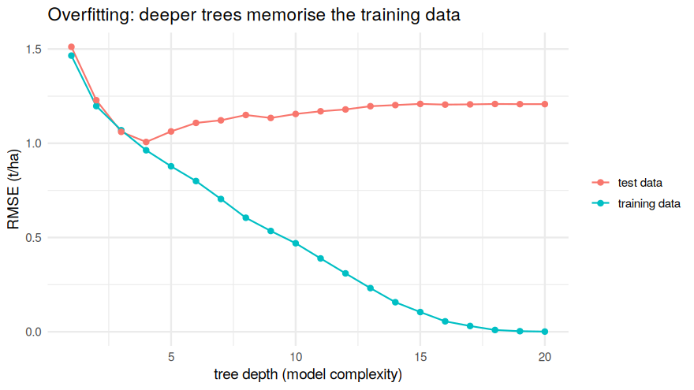
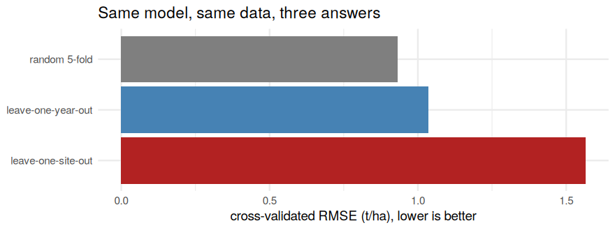
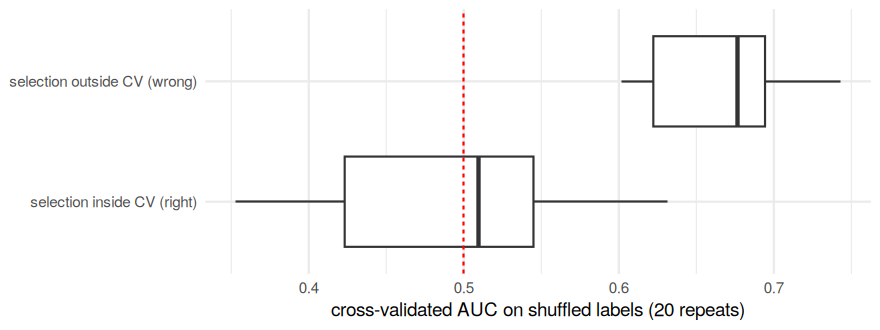

A model is only as good as the test that measures it. In biology, the most
common mistake is testing on data that are **not truly independent** of the
training data. In this lab you will make that mistake on purpose, then fix it.

- **Part A — Field trials:** overfitting, and leakage between plots from the same site
- **Part B — Population genetics:** relatives and population structure inflate genomic prediction
- **Part C — Metagenomics:** batch effects and feature-selection leakage

The key question is always: *what will the model face when it is used?*
A new plot at a known site? A new site? A new year? A new population?

```r
pkgs <- c("ggplot2", "randomForest", "glmnet", "rpart")
new <- setdiff(pkgs, rownames(installed.packages()))
if (length(new)) install.packages(new)

library(ggplot2)
library(randomForest)
library(glmnet)
library(rpart)
options(repr.plot.width = 8, repr.plot.height = 4.5, repr.plot.res = 110)
theme_set(theme_minimal(base_size = 12))

REPO <- "abu85/ai-for-agri-bio"
data_path <- function(name) {
  for (folder in c("data", "../data", "../../data")) {
    f <- file.path(folder, name)
    if (file.exists(f)) return(f)
  }
  paste0("https://raw.githubusercontent.com/", REPO, "/main/data/", name)
}

rmse <- function(obs, pred) sqrt(mean((obs - pred)^2))
auc <- function(labels, scores) {
  r <- rank(scores); n1 <- sum(labels == 1); n0 <- sum(labels == 0)
  (sum(r[labels == 1]) - n1 * (n1 + 1) / 2) / (n1 * n0)
}
set.seed(42)
```

Cross-validation helpers. A **fold** label says which test set each sample
belongs to. Random folds shuffle samples; grouped folds keep every member of a
group (site, family, field...) together.

```r
random_folds <- function(n, k = 5) sample(rep(1:k, length.out = n))
grouped_folds <- function(groups, k = 5) {
  g <- unique(groups)
  f <- sample(rep(1:k, length.out = length(g)))
  f[match(groups, g)]
}
stratified_folds <- function(labels, k = 5) {
  folds <- integer(length(labels))
  for (cl in unique(labels)) {
    idx <- which(labels == cl)
    folds[idx] <- sample(rep(1:k, length.out = length(idx)))
  }
  folds
}
# Fit on all folds but one, predict the held-out fold, repeat
cv_predict <- function(X, y, folds, fit, pred_fun) {
  pred <- rep(NA_real_, length(y))
  for (f in unique(folds)) {
    test <- folds == f
    model <- fit(X[!test, , drop = FALSE], y[!test])
    pred[test] <- pred_fun(model, X[test, , drop = FALSE])
  }
  pred
}
```

### Part A — Field trials

#### Overfitting

A decision tree can grow until it memorises every training plot. Watch the
training error fall while the test error stops improving and gets worse.

```r
trials <- read.csv(data_path("crop_trials.csv"))
trials$yield_t_ha[trials$yield_t_ha > 20] <- NA
trials$soil_ph[trials$soil_ph < 3] <- NA
trials <- trials[!is.na(trials$yield_t_ha), ]

features <- c("n_fert_kg_ha", "soil_p_mg_kg", "soil_k_mg_kg", "soil_ph", "organic_matter_pct",
              "rainfall_mm", "mean_temp_c", "irrigated", "variety")
X <- trials[, features]
for (col in names(X)) if (is.numeric(X[[col]])) X[[col]][is.na(X[[col]])] <- median(X[[col]], na.rm = TRUE)
X$variety <- factor(X$variety)
y <- trials$yield_t_ha

test_idx <- sample(nrow(X), round(0.25 * nrow(X)))
depth_curve <- do.call(rbind, lapply(1:20, function(d) {
  tree <- rpart(y ~ ., data = cbind(X[-test_idx, ], y = y[-test_idx]),
                control = rpart.control(maxdepth = min(d, 30), cp = 0, minsplit = 2, xval = 0))
  data.frame(depth = d,
             data = c("training data", "test data"),
             rmse = c(rmse(y[-test_idx], predict(tree, X[-test_idx, ])),
                      rmse(y[test_idx], predict(tree, X[test_idx, ]))))
}))
ggplot(depth_curve, aes(depth, rmse, colour = data)) +
  geom_line() + geom_point() +
  labs(title = "Overfitting: deeper trees memorise the training data",
       x = "tree depth (model complexity)", y = "RMSE (t/ha)", colour = NULL)
```

{.lab-figure}

#### Leakage between plots from the same site

A random split puts plots from the same site in both training and test sets.
The model learns each site's typical yield, and the test looks easy. But if
you want to predict yield at a **new site**, that knowledge doesn't exist.

We compare three cross-validation schemes:

- **Random 5-fold:** plots shuffled at random (the default in most tutorials)
- **Leave-one-year-out:** train on three seasons, predict the fourth
- **Leave-one-site-out:** train on seven sites, predict the eighth

```r
fit_rf <- function(X, y) randomForest(X, y, ntree = 300)
pred_rf <- function(m, X) predict(m, X)
schemes <- list("random 5-fold" = random_folds(nrow(X)),
                "leave-one-year-out" = trials$year,
                "leave-one-site-out" = trials$site)
cv_rmse <- sapply(schemes, function(folds) rmse(y, cv_predict(X, y, folds, fit_rf, pred_rf)))
round(cv_rmse, 2)
```

::: {.lab-table}
random 5-fold
:   0.93leave-one-year-out
:   1.03leave-one-site-out
:   1.56
:::

```r
options(repr.plot.height = 3)
ggplot(data.frame(scheme = factor(names(cv_rmse), levels = rev(names(cv_rmse))), rmse = cv_rmse),
       aes(rmse, scheme, fill = scheme)) +
  geom_col(show.legend = FALSE) +
  scale_fill_manual(values = c("firebrick", "steelblue", "grey50")) +
  labs(title = "Same model, same data, three answers",
       x = "cross-validated RMSE (t/ha), lower is better", y = NULL)
options(repr.plot.height = 4.5)
```

{.lab-figure}

Same model, same data — but the error at a new site is much larger than random
cross-validation suggests. **Choose the split that matches how the model will
be used**, and report that number.

**Try it:** Remove `rainfall_mm` and `mean_temp_c` from the features. How does
each CV scheme change? What does that tell you about what the model learned?

### Part B — Population genetics: relatives and population structure

Our plants come from 36 families of full siblings in three landraces. Siblings
share half their DNA. With a random split, most test plants have siblings in
the training set, so predicting them is easier than predicting a new family.
And because the landraces differ in both allele frequencies *and* height, a
model can score well just by recognising the landrace.

```r
geno <- as.matrix(read.csv(data_path("genotypes.csv"), row.names = "sample_id"))
samples <- read.csv(data_path("genotype_samples.csv"), row.names = "sample_id")
geno <- geno[rowMeans(is.na(geno)) <= 0.1, colMeans(is.na(geno)) <= 0.1]
p <- colMeans(geno, na.rm = TRUE) / 2
geno <- geno[, pmin(p, 1 - p) >= 0.05]
na_idx <- which(is.na(geno), arr.ind = TRUE)
geno[na_idx] <- colMeans(geno, na.rm = TRUE)[na_idx[, 2]]
samples <- samples[rownames(geno), ]
height <- samples$plant_height_cm

fit_ridge <- function(X, y) cv.glmnet(X, y, alpha = 0)
pred_ridge <- function(m, X) as.numeric(predict(m, X, s = "lambda.min"))
gp_schemes <- list("random 5-fold" = random_folds(nrow(geno)),
                   "new families (grouped 5-fold)" = grouped_folds(samples$family),
                   "new landrace (leave-one-out)" = samples$population)
gp_pred <- lapply(gp_schemes, function(folds) cv_predict(geno, height, folds, fit_ridge, pred_ridge))
```

We report predictive ability two ways: across all plants, and **within each
landrace** (the average correlation inside each population). Within-landrace
accuracy is what matters when a breeder selects inside one breeding population.

```r
data.frame(
  scheme = names(gp_pred),
  r_all_plants = sapply(gp_pred, function(p) round(cor(height, p), 2)),
  r_within_landrace = sapply(gp_pred, function(p) {
    round(mean(sapply(split(seq_along(p), samples$population), function(i) cor(height[i], p[i]))), 2)
  }),
  row.names = NULL
)
```

::: {.lab-table}
| scheme | r_all_plants | r_within_landrace |
|---|---|---|
| random 5-fold                 |  0.63 | 0.43 |
| new families (grouped 5-fold) |  0.48 | 0.02 |
| new landrace (leave-one-out)  | -0.27 | 0.04 |
:::

Three lessons:

1. Across all plants, random CV looks best, partly because differences
   *between* landraces are easy to predict once every landrace is in the
   training data.
2. Within landraces, accuracy is much lower — and it drops sharply for new
   families, because random CV let the model "cheat" through siblings.
3. For a landrace the model has never seen, the across-plant correlation can
   collapse or even turn negative: the model cannot know that landrace's
   average height, which here depends partly on its environment of origin.

Published genomic prediction accuracies are only comparable if you know which
scheme was used.

**Try it:** Use `flowering_days` as the trait. Do the same patterns appear?

### Part C — Metagenomics: batch effects and feature-selection leakage

#### Batch confounding

Samples were sequenced in two batches — and, by accident of lab logistics,
most diseased samples went into batch 2.

```r
counts <- as.matrix(read.csv(data_path("microbiome_counts.csv"), row.names = "sample_id"))
meta <- read.csv(data_path("microbiome_metadata.csv"), row.names = "sample_id")
taxonomy <- read.csv(data_path("microbiome_taxonomy.csv"), row.names = "taxon_id")
counts <- counts[, colMeans(counts > 0) >= 0.1]
logx <- log(counts + 0.5)
clr <- logx - rowMeans(logx)
status <- factor(meta[rownames(clr), "soil_status"], levels = c("healthy", "diseased"))
y01 <- as.integer(status == "diseased")

table(meta$soil_status, meta$seq_batch)
```

```{.text .lab-output}
          
           batch1 batch2
  diseased     28     44
  healthy      52     20
```

*Methylobacterium* and *Sphingomonas* are typical kit contaminants: they come
from the extraction reagents, not the soil, and here they are higher in batch 2.
Watch what happens if we predict disease from **contaminants only**:

```r
contaminants <- colnames(clr)[taxonomy[colnames(clr), "genus"] %in% c("Methylobacterium", "Sphingomonas")]
fit_rfc <- function(X, y) randomForest(X, y, ntree = 300)
pred_rfc <- function(m, X) predict(m, X, type = "prob")[, "diseased"]
folds <- stratified_folds(status)
cv_auc <- function(X, folds) auc(y01, cv_predict(X, status, folds, fit_rfc, pred_rfc))

cat("all taxa:             AUC =", round(cv_auc(clr, folds), 2), "\n")
cat("contaminants only:    AUC =", round(cv_auc(clr[, contaminants], folds), 2), "\n")
cat("contaminants removed: AUC =", round(cv_auc(clr[, !colnames(clr) %in% contaminants], folds), 2), "\n")
```

```{.text .lab-output}
all taxa:             AUC = 0.93 
```

```{.text .lab-output}
contaminants only:    AUC = 0.63 
```

```{.text .lab-output}
contaminants removed: AUC = 0.98 
```

Contaminants alone predict "disease" well above chance (AUC 0.5) — not because
they have anything to do with plant health, but because they mark the batch,
and the batch is linked to disease status. **A model will happily learn any
shortcut you leave in the data.** The fix starts at the design stage: randomise
samples across batches, sequence negative controls, and record batch in the
metadata.

A tougher, more honest test also asks whether the model works in a **new field**:

```r
no_contam <- clr[, !colnames(clr) %in% contaminants]
cat("random 5-fold:       AUC =", round(cv_auc(no_contam, folds), 2), "\n")
cat("leave-one-field-out: AUC =", round(cv_auc(no_contam, meta[rownames(clr), "field"]), 2), "\n")
```

```{.text .lab-output}
random 5-fold:       AUC = 0.99 
```

```{.text .lab-output}
leave-one-field-out: AUC = 0.98 
```

#### Feature-selection leakage

Omics data have many more features than samples. A tempting shortcut is to pick
the "most significant" taxa using **all** samples, then cross-validate a model
on those taxa. To see why this is wrong, we **shuffle the labels**, so there is
no real signal at all, and compare two procedures:

- **Wrong:** select the top 10 taxa on all data, then cross-validate
- **Right:** select the top 10 taxa *inside* each training fold

```r
top_k <- function(X, y, k = 10) {
  p <- apply(X, 2, function(x) t.test(x[y == 1], x[y == 0])$p.value)
  names(sort(p))[1:k]
}
fit_glm <- function(X, y) glm(y ~ ., data = data.frame(X, y = y), family = binomial)
pred_glm <- function(m, X) predict(m, data.frame(X), type = "response")
# Right: selection is part of the model, so it is redone inside each training fold
fit_sel <- function(X, y) { keep <- top_k(X, y); list(keep = keep, model = fit_glm(X[, keep], y)) }
pred_sel <- function(m, X) pred_glm(m$model, X[, m$keep])

res <- t(replicate(20, {  # repeat with 20 different label shuffles
  fake <- sample(y01)
  chosen <- top_k(clr, fake)  # Wrong: selection sees every label, including the test folds'
  c(wrong = auc(fake, cv_predict(clr[, chosen], fake, folds, fit_glm, pred_glm)),
    right = auc(fake, cv_predict(clr, fake, folds, fit_sel, pred_sel)))
}))
cat("random labels, selection outside CV: mean AUC =", round(mean(res[, "wrong"]), 2), " <- looks like signal\n")
cat("random labels, selection inside CV:  mean AUC =", round(mean(res[, "right"]), 2), " <- the truth: chance\n")
```

```{.text .lab-output}
random labels, selection outside CV: mean AUC = 0.66  <- looks like signal
```

```{.text .lab-output}
random labels, selection inside CV:  mean AUC = 0.49  <- the truth: chance
```

```r
options(repr.plot.height = 3)
ggplot(data.frame(procedure = rep(c("selection outside CV (wrong)", "selection inside CV (right)"), each = 20),
                  auc = c(res[, "wrong"], res[, "right"])), aes(auc, procedure)) +
  geom_boxplot() +
  geom_vline(xintercept = 0.5, colour = "red", linetype = 2) +
  labs(x = "cross-validated AUC on shuffled labels (20 repeats)", y = NULL)
options(repr.plot.height = 4.5)
```

{.lab-figure}

With no real signal, the wrong procedure still reports a model that "works".
**Every step that looks at the labels — feature selection, tuning, even some
normalisations — must happen inside the training folds.**

### Checklist for your own projects

- Are related samples (same plant, plot, site, family, patient, batch) kept on
  the same side of the split?
- Does the test scenario match the real use (new site, new year, new population)?
- Is there a simple baseline to beat?
- Were all label-dependent steps done inside cross-validation?
- Could a technical variable (batch, date, operator) be the real "signal"?
