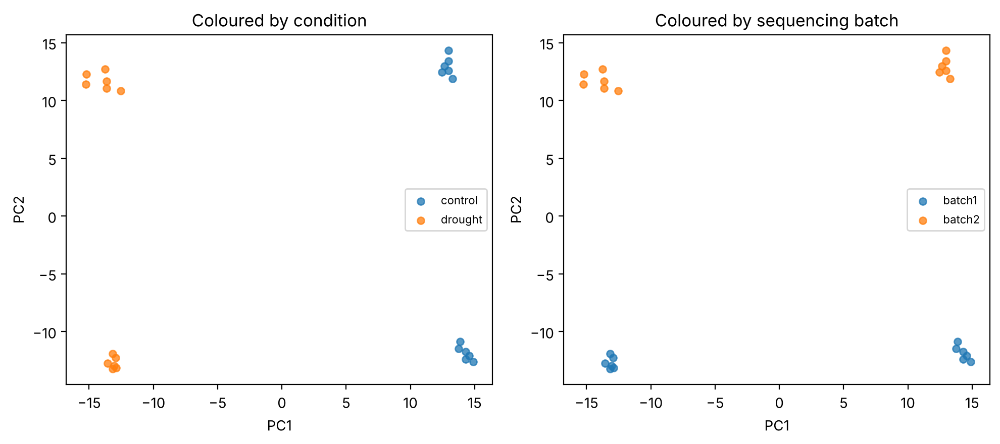
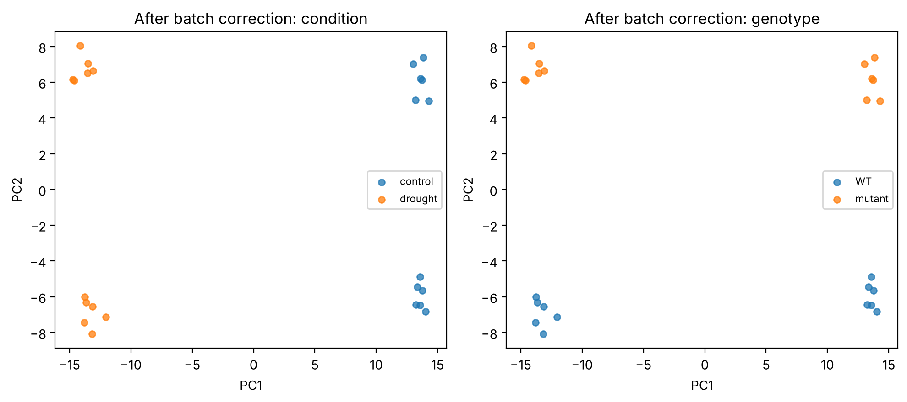
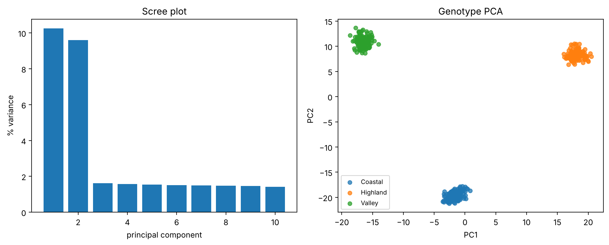
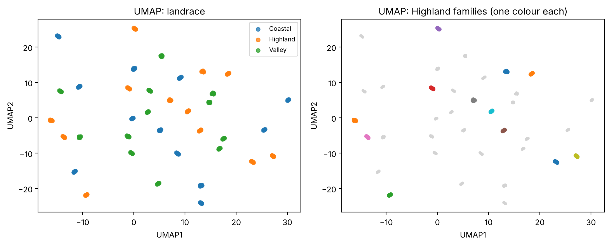
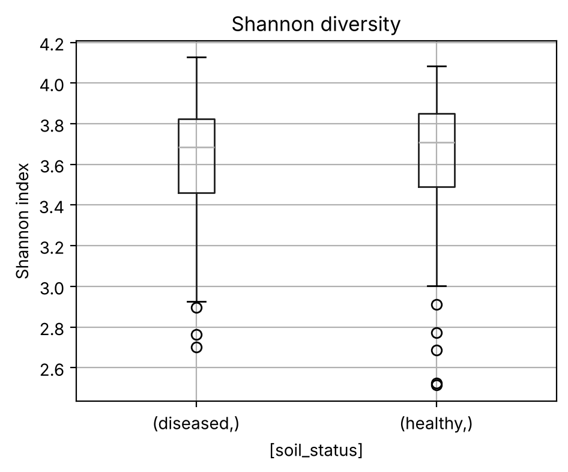
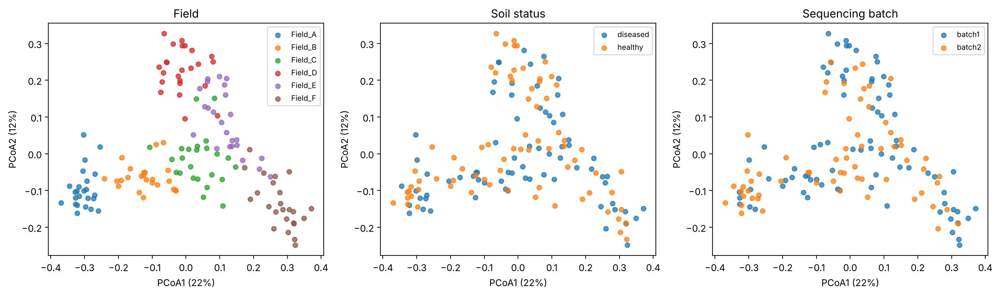

Unsupervised learning looks for patterns without being told the answer. It is
how biologists discover populations, cell types and community shifts — and how
they catch batch effects before those ruin an analysis.

- **Part A — Transcriptomics:** PCA of an RNA-seq experiment, and a batch effect
- **Part B — Population genetics:** population structure from SNPs with PCA, k-means and UMAP
- **Part C — Metagenomics:** alpha and beta diversity, PCoA and PERMANOVA

```python
import os
import subprocess
import sys

import numpy as np
import pandas as pd
import matplotlib.pyplot as plt
from scipy.spatial.distance import pdist, squareform
from sklearn.decomposition import PCA
from sklearn.cluster import KMeans
from sklearn.metrics import silhouette_score

try:
    import umap
except ImportError:  # e.g. in Colab
    subprocess.run([sys.executable, "-m", "pip", "install", "-q", "umap-learn"], check=True)
    import umap

REPO = "YOUR-GITHUB-USERNAME/ai-for-agri-bio"


def data_path(name):
    """Use the local data folder if it exists, otherwise download from GitHub."""
    for folder in ["data", "../data", "../../data"]:
        if os.path.exists(os.path.join(folder, name)):
            return os.path.join(folder, name)
    return f"https://raw.githubusercontent.com/{REPO}/main/data/{name}"


plt.rcParams["figure.figsize"] = (8, 4.5)
SEED = 42


def scatter_by(ax, xy, groups, title, xlabel="PC1", ylabel="PC2"):
    """Scatter plot of 2-D coordinates coloured by a grouping variable."""
    for g in sorted(pd.unique(groups)):
        m = np.asarray(groups == g)
        ax.scatter(xy[m, 0], xy[m, 1], label=g, alpha=0.75, s=25)
    ax.set(title=title, xlabel=xlabel, ylabel=ylabel)
    ax.legend(fontsize=8)
```

### Part A — Transcriptomics: PCA and batch effects

A drought-stress experiment: 24 *Arabidopsis*-like samples, control vs drought,
wild type vs mutant, sequenced in two batches. Each batch contains every
combination, so the design is balanced.

```python
rna = pd.read_csv(data_path("rnaseq_counts.csv"), index_col="gene_id")
rmeta = pd.read_csv(data_path("rnaseq_metadata.csv"), index_col="sample_id")
print(rna.shape)
rmeta.head()
```

```{.text .lab-output}
(2000, 24)
```

```{=html}
<div class="lab-table"><div>
<style scoped>
    .dataframe tbody tr th:only-of-type {
        vertical-align: middle;
    }

    .dataframe tbody tr th {
        vertical-align: top;
    }

    .dataframe thead th {
        text-align: right;
    }
</style>
<table border="1" class="dataframe">
  <thead>
    <tr style="text-align: right;">
      <th></th>
      <th>condition</th>
      <th>genotype</th>
      <th>seq_batch</th>
      <th>replicate</th>
    </tr>
    <tr>
      <th>sample_id</th>
      <th></th>
      <th></th>
      <th></th>
      <th></th>
    </tr>
  </thead>
  <tbody>
    <tr>
      <th>R01</th>
      <td>control</td>
      <td>WT</td>
      <td>batch1</td>
      <td>1</td>
    </tr>
    <tr>
      <th>R02</th>
      <td>control</td>
      <td>WT</td>
      <td>batch1</td>
      <td>2</td>
    </tr>
    <tr>
      <th>R03</th>
      <td>control</td>
      <td>WT</td>
      <td>batch1</td>
      <td>3</td>
    </tr>
    <tr>
      <th>R04</th>
      <td>control</td>
      <td>mutant</td>
      <td>batch1</td>
      <td>1</td>
    </tr>
    <tr>
      <th>R05</th>
      <td>control</td>
      <td>mutant</td>
      <td>batch1</td>
      <td>2</td>
    </tr>
  </tbody>
</table>
</div></div>
```

**Normalise:** counts per million (CPM) to remove library-size differences,
then log2 to tame the huge range of expression values. Keep the 500 most
variable genes, which carry most of the structure.

```python
cpm = rna / rna.sum() * 1e6
logcpm = np.log2(cpm + 1)
top = logcpm.var(axis=1).sort_values(ascending=False).index[:500]
expr = logcpm.loc[top].T  # samples as rows

pca = PCA(n_components=5).fit(expr)
pcs = pca.transform(expr)
print("variance explained:", (pca.explained_variance_ratio_ * 100).round(1), "%")

fig, axes = plt.subplots(1, 2, figsize=(10, 4.5))
scatter_by(axes[0], pcs, rmeta["condition"], "Coloured by condition")
scatter_by(axes[1], pcs, rmeta["seq_batch"], "Coloured by sequencing batch")
plt.tight_layout()
plt.show()
```

```{.text .lab-output}
variance explained: [34.3 28.1  7.8  2.3  2.3] %
```

{.lab-figure}

PC1 separates drought from control — good. But PC2, the second-largest source
of variation, is purely the sequencing batch. Because the design is balanced,
we can remove it by centring each gene within each batch. (Real analyses use tools such as `limma::removeBatchEffect`
or include batch in the statistical model, e.g. DESeq2's `~ batch + condition`.)

```python
corrected = expr.groupby(rmeta["seq_batch"]).transform(lambda x: x - x.mean())
pcs_c = PCA(n_components=2).fit_transform(corrected)

fig, axes = plt.subplots(1, 2, figsize=(10, 4.5))
scatter_by(axes[0], pcs_c, rmeta["condition"], "After batch correction: condition")
scatter_by(axes[1], pcs_c, rmeta["genotype"], "After batch correction: genotype")
plt.tight_layout()
plt.show()
```

{.lab-figure}

**Warning:** batch correction only works when batch and biology are *not*
confounded. If all drought samples had gone into batch 2, no method could
separate the two. Design experiments so that every batch contains every group.

### Part B — Population genetics: population structure

PCA of genotypes is one of the most used analyses in population genetics. It
reveals ancestry, admixture and sample mix-ups, and the top PCs are used as
covariates in GWAS to avoid false associations caused by population structure.

```python
geno = pd.read_csv(data_path("genotypes.csv"), index_col="sample_id")
samples = pd.read_csv(data_path("genotype_samples.csv"), index_col="sample_id")
geno = geno.loc[geno.isna().mean(axis=1) <= 0.1, geno.isna().mean(axis=0) <= 0.1]
p = geno.mean() / 2
geno = geno.loc[:, np.minimum(p, 1 - p) >= 0.05]
geno = geno.fillna(geno.mean())
samples = samples.loc[geno.index]

# Standardise each SNP by its expected binomial standard deviation (as in EIGENSOFT)
p = geno.mean() / 2
Z = (geno - 2 * p) / np.sqrt(2 * p * (1 - p))

pca_g = PCA(n_components=10).fit(Z)
pcs_g = pca_g.transform(Z)

fig, axes = plt.subplots(1, 2, figsize=(11, 4.5))
axes[0].bar(range(1, 11), pca_g.explained_variance_ratio_ * 100)
axes[0].set(title="Scree plot", xlabel="principal component", ylabel="% variance")
scatter_by(axes[1], pcs_g, samples["population"], "Genotype PCA")
plt.tight_layout()
plt.show()
```

{.lab-figure}

Two PCs separate three landraces: with K populations you expect about K − 1
informative PCs. The scree plot drops after PC2.

**Clustering without labels.** If we didn't know the landraces, could k-means
find them? The silhouette score helps choose the number of clusters.

```python
top_pcs = pcs_g[:, :5]
for k in range(2, 7):
    km = KMeans(n_clusters=k, n_init=10, random_state=SEED).fit(top_pcs)
    print(f"k = {k}: silhouette = {silhouette_score(top_pcs, km.labels_):.2f}")
```

```{.text .lab-output}
k = 2: silhouette = 0.44
k = 3: silhouette = 0.65
k = 4: silhouette = 0.57
k = 5: silhouette = 0.49
k = 6: silhouette = 0.34
```

```python
km = KMeans(n_clusters=3, n_init=10, random_state=SEED).fit(top_pcs)
pd.crosstab(samples["population"], km.labels_, rownames=["landrace"], colnames=["k-means cluster"])
```

```{=html}
<div class="lab-table"><div>
<style scoped>
    .dataframe tbody tr th:only-of-type {
        vertical-align: middle;
    }

    .dataframe tbody tr th {
        vertical-align: top;
    }

    .dataframe thead th {
        text-align: right;
    }
</style>
<table border="1" class="dataframe">
  <thead>
    <tr style="text-align: right;">
      <th>k-means cluster</th>
      <th>0</th>
      <th>1</th>
      <th>2</th>
    </tr>
    <tr>
      <th>landrace</th>
      <th></th>
      <th></th>
      <th></th>
    </tr>
  </thead>
  <tbody>
    <tr>
      <th>Coastal</th>
      <td>117</td>
      <td>0</td>
      <td>0</td>
    </tr>
    <tr>
      <th>Highland</th>
      <td>0</td>
      <td>0</td>
      <td>120</td>
    </tr>
    <tr>
      <th>Valley</th>
      <td>0</td>
      <td>119</td>
      <td>0</td>
    </tr>
  </tbody>
</table>
</div></div>
```

**UMAP** is a non-linear method that is popular for single-cell data. It can
also reveal finer structure — here the families inside each landrace. But
distances between UMAP clusters are not meaningful, and the picture changes
with its settings. Use it to look, not to measure.

Notice that UMAP finds every full-sib family as a tight blob, but places the
families of one landrace far apart — the landrace structure that PCA showed so
clearly is lost.

```python
emb = umap.UMAP(n_neighbors=15, min_dist=0.3, random_state=SEED).fit_transform(pcs_g)
fig, axes = plt.subplots(1, 2, figsize=(11, 4.5))
scatter_by(axes[0], emb, samples["population"], "UMAP: landrace", "UMAP1", "UMAP2")
highland = np.asarray(samples["population"] == "Highland")
for fam in sorted(samples.loc[highland, "family"].unique()):
    m = np.asarray(samples["family"] == fam)
    axes[1].scatter(emb[m, 0], emb[m, 1], s=20)
axes[1].scatter(emb[~highland, 0], emb[~highland, 1], s=8, color="lightgray")
axes[1].set(title="UMAP: Highland families (one colour each)", xlabel="UMAP1", ylabel="UMAP2")
plt.tight_layout()
plt.show()
```

{.lab-figure}

**Try it:** Run k-means with k = 36 on the first 10 PCs and compare the
clusters with the families. Are full-sib families detectable from genotypes?

### Part C — Metagenomics: diversity and community structure

**Alpha diversity** describes a single sample (how many taxa, how even).
**Beta diversity** compares samples (how different are two communities).

```python
counts = pd.read_csv(data_path("microbiome_counts.csv"), index_col="sample_id")
meta = pd.read_csv(data_path("microbiome_metadata.csv"), index_col="sample_id")
rel = counts.div(counts.sum(axis=1), axis=0)


def shannon(row):
    x = row[row > 0]
    return -(x * np.log(x)).sum()


meta["shannon"] = rel.apply(shannon, axis=1)
meta.boxplot(column="shannon", by=["soil_status"], figsize=(5, 4))
plt.suptitle("")
plt.title("Shannon diversity")
plt.ylabel("Shannon index")
plt.show()
```

{.lab-figure}

Library sizes differ, and richness depends on sequencing depth. For a fair
comparison of richness, samples are often **rarefied** (subsampled) to the same
depth first. Shannon diversity on relative abundances is less sensitive.

**Beta diversity: Bray–Curtis distance and PCoA.** Bray–Curtis measures how
different two communities are (0 = identical, 1 = nothing shared). Principal
coordinates analysis (PCoA) draws those distances in two dimensions.

```python
D = squareform(pdist(rel.values, metric="braycurtis"))


def pcoa(D, k=2):
    """Classical multidimensional scaling (PCoA) of a distance matrix."""
    n = D.shape[0]
    J = np.eye(n) - np.ones((n, n)) / n
    B = -0.5 * J @ (D**2) @ J
    vals, vecs = np.linalg.eigh(B)
    order = np.argsort(vals)[::-1]
    vals, vecs = vals[order], vecs[:, order]
    explained = vals[:k] / vals[vals > 0].sum()
    return vecs[:, :k] * np.sqrt(vals[:k]), explained


coords, expl = pcoa(D)
xl, yl = f"PCoA1 ({expl[0]:.0%})", f"PCoA2 ({expl[1]:.0%})"
fig, axes = plt.subplots(1, 3, figsize=(15, 4.5))
scatter_by(axes[0], coords, meta["field"], "Field", xl, yl)
scatter_by(axes[1], coords, meta["soil_status"], "Soil status", xl, yl)
scatter_by(axes[2], coords, meta["seq_batch"], "Sequencing batch", xl, yl)
plt.tight_layout()
plt.show()
```

{.lab-figure}

**PERMANOVA** tests whether groups differ in community composition, using the
distance matrix and permutations. R² is the share of variation explained by
the grouping. (In R, this is `vegan::adonis2`; here is a compact version.)

```python
def permanova(D, groups, n_perm=999, seed=SEED):
    """One-factor PERMANOVA. Returns pseudo-F, R2 and permutation p-value."""
    D2 = D**2
    n = len(groups)
    groups = np.asarray(groups)

    def stats_for(g):
        labels = np.unique(g)
        ss_total = D2[np.triu_indices(n, 1)].sum() / n
        ss_within = 0.0
        for lab in labels:
            idx = np.where(g == lab)[0]
            sub = D2[np.ix_(idx, idx)]
            ss_within += sub[np.triu_indices(len(idx), 1)].sum() / len(idx)
        ss_between = ss_total - ss_within
        a = len(labels)
        return (ss_between / (a - 1)) / (ss_within / (n - a)), ss_between / ss_total

    f_obs, r2 = stats_for(groups)
    rng = np.random.default_rng(seed)
    f_perm = np.array([stats_for(rng.permutation(groups))[0] for _ in range(n_perm)])
    p = (np.sum(f_perm >= f_obs) + 1) / (n_perm + 1)
    return pd.Series({"pseudo_F": round(f_obs, 2), "R2": round(r2, 3), "p_value": round(p, 3)})


pd.DataFrame({factor: permanova(D, meta[factor]) for factor in ["field", "soil_status", "seq_batch"]}).T
```

```{=html}
<div class="lab-table"><div>
<style scoped>
    .dataframe tbody tr th:only-of-type {
        vertical-align: middle;
    }

    .dataframe tbody tr th {
        vertical-align: top;
    }

    .dataframe thead th {
        text-align: right;
    }
</style>
<table border="1" class="dataframe">
  <thead>
    <tr style="text-align: right;">
      <th></th>
      <th>pseudo_F</th>
      <th>R2</th>
      <th>p_value</th>
    </tr>
  </thead>
  <tbody>
    <tr>
      <th>field</th>
      <td>25.94</td>
      <td>0.485</td>
      <td>0.001</td>
    </tr>
    <tr>
      <th>soil_status</th>
      <td>3.89</td>
      <td>0.027</td>
      <td>0.001</td>
    </tr>
    <tr>
      <th>seq_batch</th>
      <td>11.63</td>
      <td>0.076</td>
      <td>0.001</td>
    </tr>
  </tbody>
</table>
</div></div>
```

Field (location and soil pH) explains by far the most variation. More
worrying: **sequencing batch explains more than soil status** — partly
because of the contaminants we met in Lab 04, and partly because batch is
confounded with status. All three are "significant", which is why R² (effect
size) matters more than the p-value.
A real analysis would test status *within* fields and include batch
(e.g. `adonis2(D ~ field + seq_batch + soil_status)` in R).

**Try it:** Repeat the PCoA with Jaccard distance (presence/absence:
`pdist(rel > 0, metric="jaccard")`). Does the picture change?
