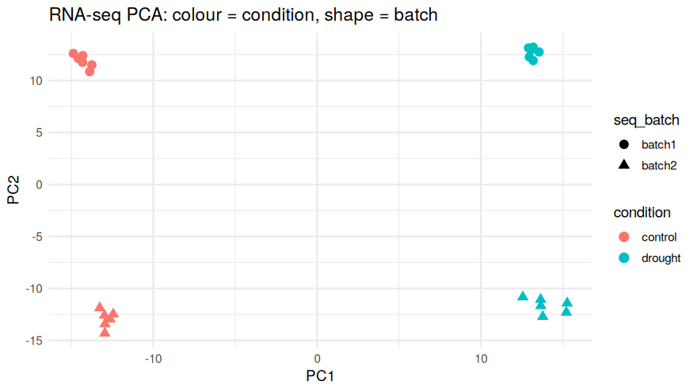
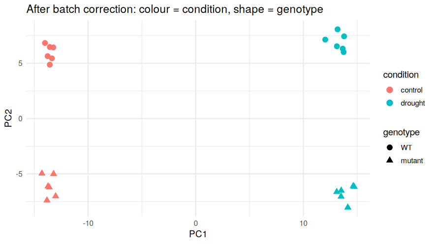
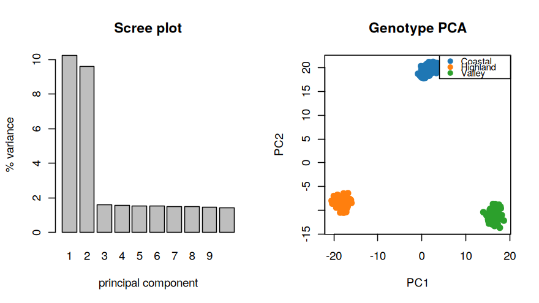
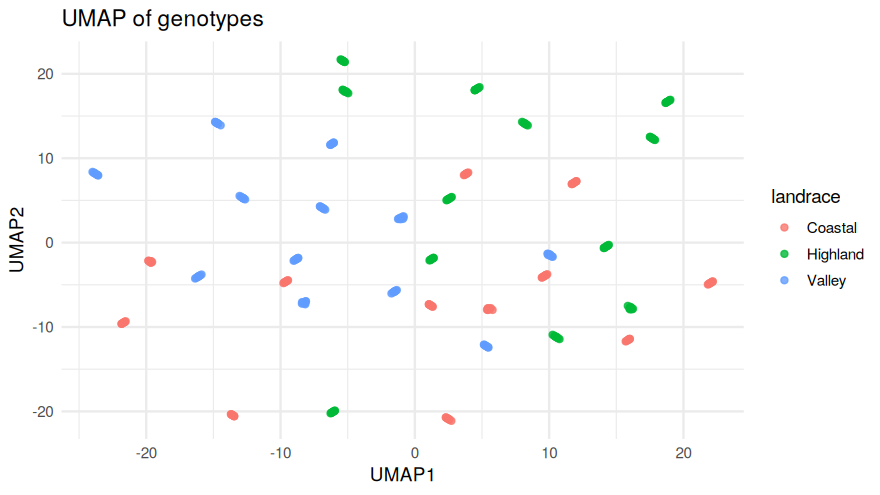
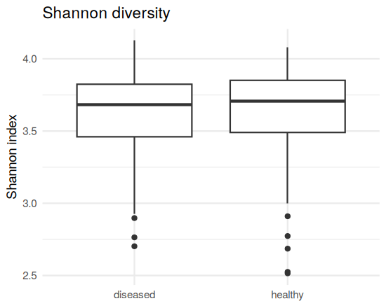
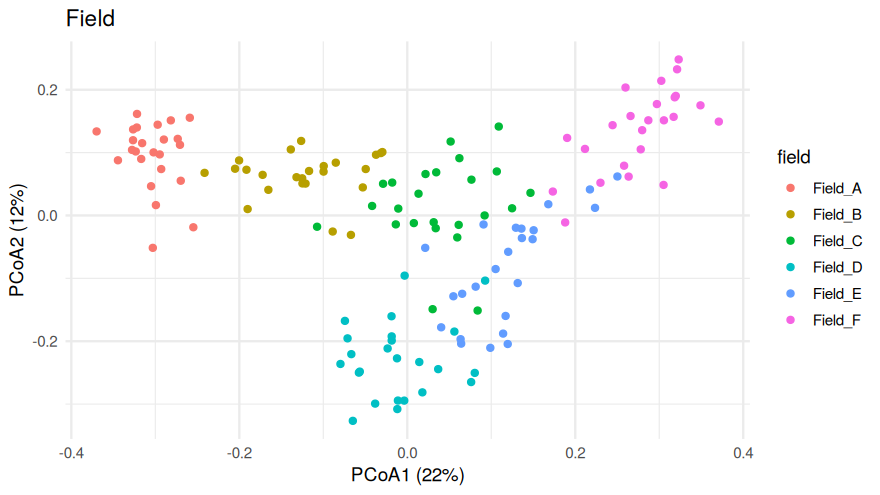
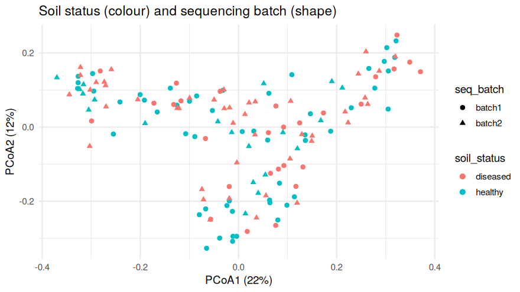

Unsupervised learning looks for patterns without being told the answer. It is
how biologists discover populations, cell types and community shifts — and how
they catch batch effects before those ruin an analysis.

- **Part A — Transcriptomics:** PCA of an RNA-seq experiment, and a batch effect
- **Part B — Population genetics:** population structure from SNPs with PCA, k-means and UMAP
- **Part C — Metagenomics:** alpha and beta diversity, PCoA and PERMANOVA

```r
pkgs <- c("ggplot2", "vegan", "uwot", "cluster")
new <- setdiff(pkgs, rownames(installed.packages()))
if (length(new)) install.packages(new)

library(ggplot2)
library(vegan)
library(uwot)
library(cluster)
options(repr.plot.width = 8, repr.plot.height = 4.5, repr.plot.res = 110)
theme_set(theme_minimal(base_size = 12))

REPO <- "YOUR-GITHUB-USERNAME/ai-for-agri-bio"
data_path <- function(name) {
  for (folder in c("data", "../data", "../../data")) {
    f <- file.path(folder, name)
    if (file.exists(f)) return(f)
  }
  paste0("https://raw.githubusercontent.com/", REPO, "/main/data/", name)
}
set.seed(42)
```

### Part A — Transcriptomics: PCA and batch effects

A drought-stress experiment: 24 *Arabidopsis*-like samples, control vs drought,
wild type vs mutant, sequenced in two batches. Each batch contains every
combination, so the design is balanced.

```r
rna <- as.matrix(read.csv(data_path("rnaseq_counts.csv"), row.names = "gene_id"))
rmeta <- read.csv(data_path("rnaseq_metadata.csv"), row.names = "sample_id")
dim(rna)
head(rmeta)
```

::: {.lab-table}
1. 2000
2. 24
:::

::: {.lab-table}
| <!--/--> | condition | genotype | seq_batch | replicate |
|---|---|---|---|---|
| R01 | control | WT     | batch1 | 1 |
| R02 | control | WT     | batch1 | 2 |
| R03 | control | WT     | batch1 | 3 |
| R04 | control | mutant | batch1 | 1 |
| R05 | control | mutant | batch1 | 2 |
| R06 | control | mutant | batch1 | 3 |
:::

**Normalise:** counts per million (CPM) to remove library-size differences,
then log2 to tame the huge range of expression values. Keep the 500 most
variable genes, which carry most of the structure.

```r
cpm <- t(t(rna) / colSums(rna)) * 1e6
logcpm <- log2(cpm + 1)
top <- order(apply(logcpm, 1, var), decreasing = TRUE)[1:500]
expr <- t(logcpm[top, ])  # samples as rows

pca <- prcomp(expr, center = TRUE)
cat("variance explained (%):", round(100 * summary(pca)$importance[2, 1:5], 1), "\n")

pc_df <- data.frame(pca$x[, 1:2], rmeta[rownames(expr), ])
ggplot(pc_df, aes(PC1, PC2, colour = condition, shape = seq_batch)) +
  geom_point(size = 3) +
  labs(title = "RNA-seq PCA: colour = condition, shape = batch")
```

```{.text .lab-output}
variance explained (%): 34.3 28.1 7.8 2.3 2.3 
```

{.lab-figure}

PC1 separates drought from control — good. But PC2, the second-largest source
of variation, is purely the sequencing batch. Because the design is balanced,
we can remove it by centring each gene within each batch. (Real analyses use
`limma::removeBatchEffect` or include batch in the model, e.g. DESeq2's
`~ batch + condition`.)

```r
corrected <- expr
for (b in unique(rmeta$seq_batch)) {
  idx <- rmeta[rownames(expr), "seq_batch"] == b
  corrected[idx, ] <- scale(expr[idx, ], center = TRUE, scale = FALSE)
}
pc_c <- data.frame(prcomp(corrected)$x[, 1:2], rmeta[rownames(expr), ])
ggplot(pc_c, aes(PC1, PC2, colour = condition, shape = genotype)) +
  geom_point(size = 3) +
  labs(title = "After batch correction: colour = condition, shape = genotype")
```

{.lab-figure}

**Warning:** batch correction only works when batch and biology are *not*
confounded. If all drought samples had gone into batch 2, no method could
separate the two. Design experiments so that every batch contains every group.

### Part B — Population genetics: population structure

PCA of genotypes is one of the most used analyses in population genetics. It
reveals ancestry, admixture and sample mix-ups, and the top PCs are used as
covariates in GWAS to avoid false associations caused by population structure.

```r
geno <- as.matrix(read.csv(data_path("genotypes.csv"), row.names = "sample_id"))
samples <- read.csv(data_path("genotype_samples.csv"), row.names = "sample_id")
geno <- geno[rowMeans(is.na(geno)) <= 0.1, colMeans(is.na(geno)) <= 0.1]
p <- colMeans(geno, na.rm = TRUE) / 2
geno <- geno[, pmin(p, 1 - p) >= 0.05]
na_idx <- which(is.na(geno), arr.ind = TRUE)
geno[na_idx] <- colMeans(geno, na.rm = TRUE)[na_idx[, 2]]
samples <- samples[rownames(geno), ]

# Standardise each SNP by its expected binomial standard deviation (as in EIGENSOFT)
p <- colMeans(geno) / 2
Z <- sweep(sweep(geno, 2, 2 * p), 2, sqrt(2 * p * (1 - p)), "/")
pca_g <- prcomp(Z, center = FALSE)
var_expl <- 100 * pca_g$sdev^2 / sum(pca_g$sdev^2)

par(mfrow = c(1, 2))
barplot(var_expl[1:10], names.arg = 1:10, main = "Scree plot", xlab = "principal component", ylab = "% variance")
cols <- c(Coastal = "#1f77b4", Highland = "#ff7f0e", Valley = "#2ca02c")
plot(pca_g$x[, 1:2], col = cols[samples$population], pch = 19, main = "Genotype PCA")
legend("topright", legend = names(cols), col = cols, pch = 19, cex = 0.8)
par(mfrow = c(1, 1))
```

{.lab-figure}

Two PCs separate three landraces: with K populations you expect about K − 1
informative PCs. The scree plot drops after PC2.

**Clustering without labels.** If we didn't know the landraces, could k-means
find them? The silhouette score helps choose the number of clusters.

```r
top_pcs <- pca_g$x[, 1:5]
d <- dist(top_pcs)
for (k in 2:6) {
  km <- kmeans(top_pcs, centers = k, nstart = 10)
  cat("k =", k, ": silhouette =", round(mean(silhouette(km$cluster, d)[, 3]), 2), "\n")
}
```

```{.text .lab-output}
k = 2 : silhouette = 0.44 
k = 3 : silhouette = 0.65 
k = 4 : silhouette = 0.57 
k = 5 : silhouette = 0.59 
k = 6 : silhouette = 0.32 
```

```r
km <- kmeans(top_pcs, centers = 3, nstart = 10)
table(landrace = samples$population, kmeans_cluster = km$cluster)
```

```{.text .lab-output}
          kmeans_cluster
landrace     1   2   3
  Coastal  117   0   0
  Highland   0 120   0
  Valley     0   0 119
```

**UMAP** is a non-linear method that is popular for single-cell data. It can
also reveal finer structure — here the families inside each landrace. But
distances between UMAP clusters are not meaningful, and the picture changes
with its settings. Use it to look, not to measure.

```r
emb <- umap(pca_g$x[, 1:10], n_neighbors = 15, min_dist = 0.3)
umap_df <- data.frame(UMAP1 = emb[, 1], UMAP2 = emb[, 2], landrace = samples$population)
ggplot(umap_df, aes(UMAP1, UMAP2, colour = landrace)) +
  geom_point(alpha = 0.8) +
  labs(title = "UMAP of genotypes")
```

{.lab-figure}

Notice that UMAP finds every full-sib family as a tight blob, but places the
families of one landrace far apart — the landrace structure that PCA showed so
clearly is lost.

**Try it:** Run k-means with k = 36 on the first 10 PCs and compare the
clusters with the families. Are full-sib families detectable from genotypes?

### Part C — Metagenomics: diversity and community structure

**Alpha diversity** describes a single sample (how many taxa, how even).
**Beta diversity** compares samples (how different are two communities).
The `vegan` package is the standard toolbox for community ecology in R.

```r
counts <- as.matrix(read.csv(data_path("microbiome_counts.csv"), row.names = "sample_id"))
meta <- read.csv(data_path("microbiome_metadata.csv"), row.names = "sample_id")
meta <- meta[rownames(counts), ]
rel <- counts / rowSums(counts)

meta$shannon <- diversity(rel, index = "shannon")
options(repr.plot.width = 5, repr.plot.height = 4)
ggplot(meta, aes(soil_status, shannon)) +
  geom_boxplot() +
  labs(title = "Shannon diversity", x = NULL, y = "Shannon index")
options(repr.plot.width = 8, repr.plot.height = 4.5)
```

{.lab-figure}

Library sizes differ, and richness depends on sequencing depth. For a fair
comparison of richness, samples are often **rarefied** (subsampled) to the same
depth first (`vegan::rrarefy`). Shannon diversity on relative abundances is
less sensitive.

**Beta diversity: Bray–Curtis distance and PCoA.** Bray–Curtis measures how
different two communities are (0 = identical, 1 = nothing shared). Principal
coordinates analysis (PCoA) draws those distances in two dimensions.

```r
D <- vegdist(rel, method = "bray")
pcoa <- cmdscale(D, k = 2, eig = TRUE)
expl <- pcoa$eig[1:2] / sum(pcoa$eig[pcoa$eig > 0])
pcoa_df <- data.frame(PCoA1 = pcoa$points[, 1], PCoA2 = pcoa$points[, 2], meta)
axis_labs <- labs(x = sprintf("PCoA1 (%.0f%%)", 100 * expl[1]), y = sprintf("PCoA2 (%.0f%%)", 100 * expl[2]))

ggplot(pcoa_df, aes(PCoA1, PCoA2, colour = field)) + geom_point() + axis_labs + ggtitle("Field")
```

{.lab-figure}

```r
ggplot(pcoa_df, aes(PCoA1, PCoA2, colour = soil_status, shape = seq_batch)) +
  geom_point(size = 2) + axis_labs + ggtitle("Soil status (colour) and sequencing batch (shape)")
```

{.lab-figure}

**PERMANOVA** tests whether groups differ in community composition, using the
distance matrix and permutations. R² is the share of variation explained by
the grouping. In R, this is `vegan::adonis2`.

```r
res <- lapply(c("field", "soil_status", "seq_batch"), function(f) {
  a <- adonis2(D ~ meta[[f]], permutations = 999)
  data.frame(factor = f, pseudo_F = round(a$F[1], 2), R2 = round(a$R2[1], 3), p_value = a$`Pr(>F)`[1])
})
do.call(rbind, res)
```

::: {.lab-table}
| factor | pseudo_F | R2 | p_value |
|---|---|---|---|
| field       | 25.94 | 0.485 | 0.001 |
| soil_status |  3.89 | 0.027 | 0.001 |
| seq_batch   | 11.63 | 0.076 | 0.001 |
:::

Field (location and soil pH) explains by far the most variation. More
worrying: **sequencing batch explains more than soil status** — partly
because of the contaminants we met in Lab 04, and partly because batch is
confounded with status. All three are "significant", which is why R² (effect
size) matters more than the p-value.

A better model accounts for field and batch before testing status:

```r
adonis2(D ~ field + seq_batch + soil_status, data = meta, permutations = 999, by = "terms")
```

::: {.lab-table}
A anova.cca: 5 × 5

| <!--/--> | Df | SumOfSqs | R2 | F | Pr(&gt;F) |
|---|---|---|---|---|---|
| field |   5 | 10.5096552 | 0.48454098 | 30.629255 | 0.001 |
| seq_batch |   1 |  1.4787305 | 0.06817593 | 21.548002 | 0.001 |
| soil_status |   1 |  0.3685418 | 0.01699139 |  5.370376 | 0.001 |
| Residual | 136 |  9.3329928 | 0.43029171 |        NA |    NA |
| Total | 143 | 21.6899203 | 1.00000000 |        NA |    NA |
:::

**Try it:** Repeat the PCoA with Jaccard distance on presence/absence
(`vegdist(rel > 0, method = "jaccard")`). Does the picture change?
