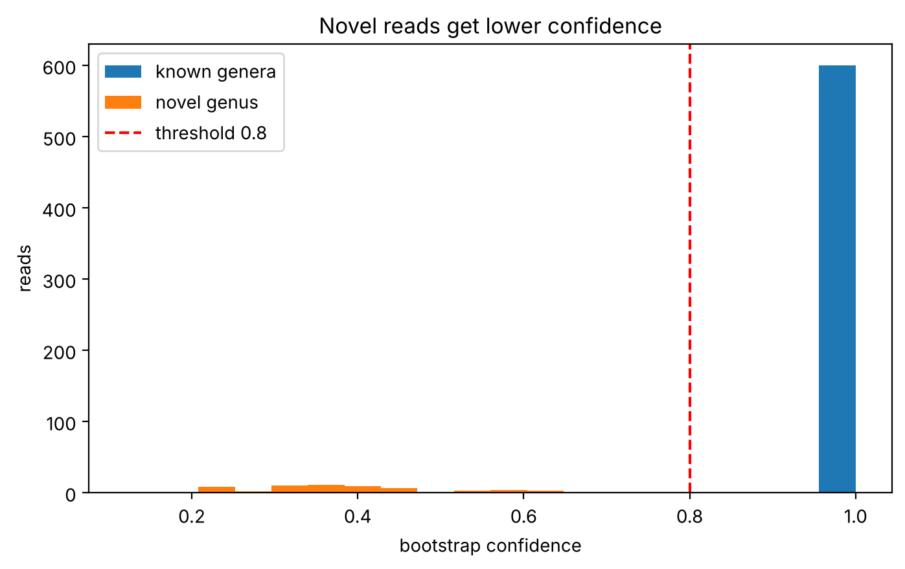
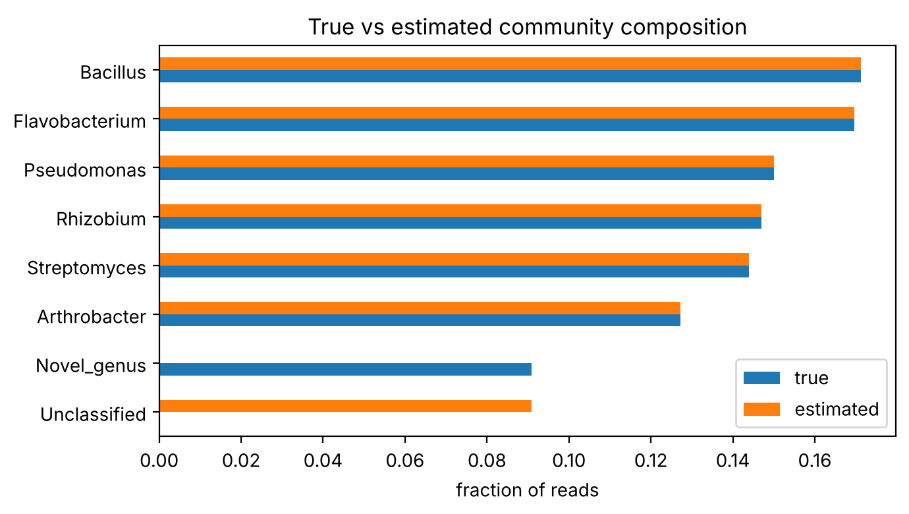

A metagenomics run produces millions of short DNA reads. Before anything else,
each read must be assigned to a taxon. Widely used tools such as the **RDP
classifier** and **QIIME 2's naive Bayes classifier** (for 16S amplicons), or
**Kraken 2** (for shotgun data), are built on the same idea: break sequences
into short words called **k-mers** and compare their k-mer content with a
labelled reference database.

In this lab you build such a classifier from scratch:

1. Turn DNA sequences into k-mer count vectors
2. Train a naive Bayes classifier on reference sequences of known genera
3. Classify reads from an unknown soil sample, with bootstrap confidence
4. Catch reads from a genus that is **not** in the reference database
5. Estimate the community composition of the sample

The sequences are synthetic (they mimic the conserved and variable regions of
a 16S gene) so the lab runs anywhere in seconds.

```python
import os
import urllib.request

import numpy as np
import pandas as pd
import matplotlib.pyplot as plt
from sklearn.feature_extraction.text import CountVectorizer
from sklearn.naive_bayes import MultinomialNB

REPO = "abu85/ai-for-agri-bio"


def data_path(name):
    """Use the local data folder if it exists, otherwise download from GitHub."""
    for folder in ["data", "../data", "../../data"]:
        if os.path.exists(os.path.join(folder, name)):
            return os.path.join(folder, name)
    return f"https://raw.githubusercontent.com/{REPO}/main/data/{name}"


def read_fasta(path):
    """Minimal FASTA reader: returns lists of headers and sequences."""
    if path.startswith("http"):
        text = urllib.request.urlopen(path).read().decode().splitlines()
    else:
        text = open(path).read().splitlines()
    headers, seqs = [], []
    for line in text:
        if line.startswith(">"):
            headers.append(line[1:])
            seqs.append("")
        else:
            seqs[-1] += line.strip()
    return headers, seqs


plt.rcParams["figure.figsize"] = (8, 4.5)
SEED = 42
rng = np.random.default_rng(SEED)
```

### 1. The reference database

72 reference sequences from 6 genera (3 species, 4 strains each). The genus is
written in each FASTA header.

```python
ref_headers, ref_seqs = read_fasta(data_path("16s_reference.fasta"))
ref_genus = [h.split("genus=")[1] for h in ref_headers]
print(ref_headers[0])
print(ref_seqs[0][:120], "...")
pd.Series(ref_genus).value_counts()
```

```{.text .lab-output}
Bacillus_sp1_strain1 genus=Bacillus
CGTCGGCAATGTCAGTTACGATGTCGGTCAGGCTATTCGATCACCCGTTCGGGTGATGGATTCGCCAAATCCGTCGCGCACAATGCTACCGATTTCGGTCGGTCCGACCCGTTGTGAGGG ...
```

```{.text .lab-output}
Bacillus          12
Pseudomonas       12
Streptomyces      12
Rhizobium         12
Flavobacterium    12
Arthrobacter      12
Name: count, dtype: int64
```

### 2. From sequence to k-mers

A k-mer is every substring of length k. A read of length L has L − k + 1
k-mers. With k = 6 there are 4⁶ = 4,096 possible k-mers, so every sequence
becomes a vector of 4,096 counts.

```python
k = 6
example = "ACGTACGGTA"
print([example[i:i + k] for i in range(len(example) - k + 1)])
```

```{.text .lab-output}
['ACGTAC', 'CGTACG', 'GTACGG', 'TACGGT', 'ACGGTA']
```

```python
vectorizer = CountVectorizer(analyzer="char", ngram_range=(k, k), lowercase=False)
R = vectorizer.fit_transform(ref_seqs)
print(f"reference matrix: {R.shape[0]} sequences x {R.shape[1]} distinct k-mers")
```

```{.text .lab-output}
reference matrix: 72 sequences x 2518 distinct k-mers
```

### 3. Train a naive Bayes classifier

Naive Bayes learns how often each k-mer occurs in each genus. To classify a
read, it asks: *which genus would most likely produce this collection of
k-mers?* It is "naive" because it treats k-mers as independent — wrong, but it
works remarkably well and is very fast.

```python
nb = MultinomialNB(alpha=0.01).fit(R, ref_genus)

query_headers, query_seqs = read_fasta(data_path("16s_query_reads.fasta"))
read_ids = [h.split()[0] for h in query_headers]
truth = pd.read_csv(data_path("16s_query_truth.csv"), index_col="read_id").loc[read_ids, "true_genus"].values
Q = vectorizer.transform(query_seqs)
pred = nb.predict(Q)
print(f"{len(query_seqs)} reads of length {len(query_seqs[0])}")
```

```{.text .lab-output}
660 reads of length 150
```

The answer key (`16s_query_truth.csv`) is only available because the data are
simulated. How good are the predictions for reads from genera that are in the
reference?

```python
known = truth != "Novel_genus"
print(f"accuracy on reads from known genera: {(pred[known] == truth[known]).mean():.3f}")
pd.crosstab(pd.Series(truth, name="true genus"), pd.Series(pred, name="predicted genus"))
```

```{.text .lab-output}
accuracy on reads from known genera: 1.000
```

```{=html}
<div class="lab-table"><div>
<style scoped>
    .dataframe tbody tr th:only-of-type {
        vertical-align: middle;
    }

    .dataframe tbody tr th {
        vertical-align: top;
    }

    .dataframe thead th {
        text-align: right;
    }
</style>
<table border="1" class="dataframe">
  <thead>
    <tr style="text-align: right;">
      <th>predicted genus</th>
      <th>Arthrobacter</th>
      <th>Bacillus</th>
      <th>Flavobacterium</th>
      <th>Pseudomonas</th>
      <th>Rhizobium</th>
      <th>Streptomyces</th>
    </tr>
    <tr>
      <th>true genus</th>
      <th></th>
      <th></th>
      <th></th>
      <th></th>
      <th></th>
      <th></th>
    </tr>
  </thead>
  <tbody>
    <tr>
      <th>Arthrobacter</th>
      <td>84</td>
      <td>0</td>
      <td>0</td>
      <td>0</td>
      <td>0</td>
      <td>0</td>
    </tr>
    <tr>
      <th>Bacillus</th>
      <td>0</td>
      <td>113</td>
      <td>0</td>
      <td>0</td>
      <td>0</td>
      <td>0</td>
    </tr>
    <tr>
      <th>Flavobacterium</th>
      <td>0</td>
      <td>0</td>
      <td>112</td>
      <td>0</td>
      <td>0</td>
      <td>0</td>
    </tr>
    <tr>
      <th>Novel_genus</th>
      <td>1</td>
      <td>18</td>
      <td>12</td>
      <td>2</td>
      <td>20</td>
      <td>7</td>
    </tr>
    <tr>
      <th>Pseudomonas</th>
      <td>0</td>
      <td>0</td>
      <td>0</td>
      <td>99</td>
      <td>0</td>
      <td>0</td>
    </tr>
    <tr>
      <th>Rhizobium</th>
      <td>0</td>
      <td>0</td>
      <td>0</td>
      <td>0</td>
      <td>97</td>
      <td>0</td>
    </tr>
    <tr>
      <th>Streptomyces</th>
      <td>0</td>
      <td>0</td>
      <td>0</td>
      <td>0</td>
      <td>0</td>
      <td>95</td>
    </tr>
  </tbody>
</table>
</div></div>
```

The bottom row is the problem: reads from a genus that is **missing from the
database** are still forced into one of the known genera. A classifier can only
choose among the labels it was trained on. And it is confident about it:

```python
post = nb.predict_proba(Q).max(axis=1)
print(f"mean naive Bayes probability, known genera: {post[known].mean():.3f}")
print(f"mean naive Bayes probability, novel genus:  {post[~known].mean():.3f}")
```

```{.text .lab-output}
mean naive Bayes probability, known genera: 1.000
mean naive Bayes probability, novel genus:  0.984
```

### 4. Bootstrap confidence, as in the RDP classifier

The RDP classifier estimates confidence differently: it classifies many random
subsets of each read's k-mers (here 50 subsets, each 1/8 of the k-mers) and
counts how often the subsets agree with the full read. A read that truly
belongs to a genus gives the same answer from almost any subset; a read from an
unknown genus does not.

```python
def bootstrap_confidence(Q, pred, n_boot=50, frac=1 / 8):
    Qd = Q.toarray()
    conf = np.zeros(len(pred))
    for i in range(Qd.shape[0]):
        kmers = np.repeat(np.arange(Qd.shape[1]), Qd[i])
        n = max(1, int(len(kmers) * frac))
        samples = rng.choice(kmers, size=(n_boot, n))
        boot = np.zeros((n_boot, Qd.shape[1]))
        np.add.at(boot, (np.repeat(np.arange(n_boot), n), samples.ravel()), 1)
        conf[i] = np.mean(nb.predict(boot) == pred[i])
    return conf


conf = bootstrap_confidence(Q, pred)

plt.hist([conf[known], conf[~known]], bins=20, label=["known genera", "novel genus"], stacked=True)
plt.axvline(0.8, color="red", ls="--", label="threshold 0.8")
plt.xlabel("bootstrap confidence")
plt.ylabel("reads")
plt.legend()
plt.title("Novel reads get lower confidence")
plt.show()
```

{.lab-figure}

```python
threshold = 0.8
assigned = np.where(conf >= threshold, pred, "Unclassified")
print(f"known-genus reads kept:   {(conf[known] >= threshold).mean():.0%}")
print(f"novel-genus reads caught: {(conf[~known] < threshold).mean():.0%}")
```

```{.text .lab-output}
known-genus reads kept:   100%
novel-genus reads caught: 100%
```

The RDP classifier's default threshold is 0.8. Raising it catches more unknown
reads but discards more good ones — a trade-off you should report, not hide.

### 5. Community composition of the sample

Finally, the result a biologist actually wants: what is in this soil?

```python
comp = pd.DataFrame({
    "true": pd.Series(truth).value_counts(normalize=True),
    "estimated": pd.Series(assigned).value_counts(normalize=True),
}).fillna(0).sort_values("true")
comp.plot(kind="barh", figsize=(7, 4))
plt.xlabel("fraction of reads")
plt.title("True vs estimated community composition")
plt.tight_layout()
plt.show()
```

{.lab-figure}

**Discussion points**

- Real reference databases (SILVA, GTDB, RefSeq) are huge but still incomplete,
  especially for soil microbes. Unclassified reads are normal, not a failure.
- Genus-level assignment from a short amplicon is often reliable; species-level
  often is not. Report the level your data can support.
- Deep learning classifiers and DNA language models exist, but k-mer methods
  remain the standard because they are fast, transparent and accurate.

**Try it:** Change `k` to 4 and to 10. How do accuracy and the novel-read
confidence change? Why might very short and very long k-mers both be worse?
