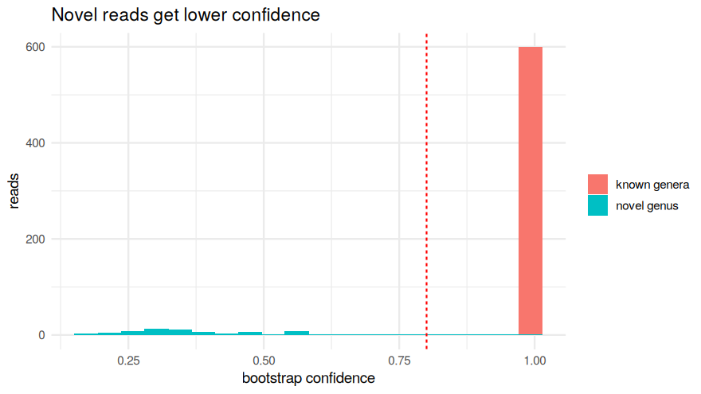
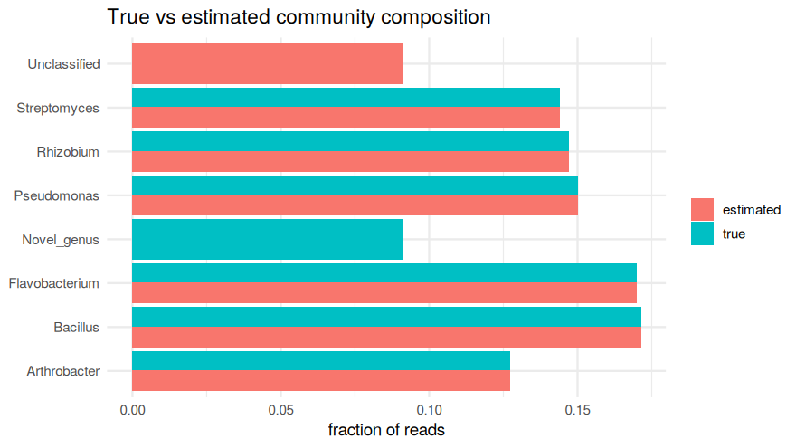

A metagenomics run produces millions of short DNA reads. Before anything else,
each read must be assigned to a taxon. Widely used tools such as the **RDP
classifier** and **QIIME 2's naive Bayes classifier** (for 16S amplicons), or
**Kraken 2** (for shotgun data), are built on the same idea: break sequences
into short words called **k-mers** and compare their k-mer content with a
labelled reference database. (In R, `dada2::assignTaxonomy` implements the
RDP method.)

In this lab you build such a classifier from scratch:

1. Turn DNA sequences into k-mer count vectors
2. Train a naive Bayes classifier on reference sequences of known genera
3. Classify reads from an unknown soil sample, with bootstrap confidence
4. Catch reads from a genus that is **not** in the reference database
5. Estimate the community composition of the sample

The sequences are synthetic (they mimic the conserved and variable regions of
a 16S gene) so the lab runs anywhere in seconds.

```r
pkgs <- c("ggplot2")
new <- setdiff(pkgs, rownames(installed.packages()))
if (length(new)) install.packages(new)

library(ggplot2)
options(repr.plot.width = 8, repr.plot.height = 4.5, repr.plot.res = 110)
theme_set(theme_minimal(base_size = 12))

REPO <- "abu85/ai-for-agri-bio"
data_path <- function(name) {
  for (folder in c("data", "../data", "../../data")) {
    f <- file.path(folder, name)
    if (file.exists(f)) return(f)
  }
  paste0("https://raw.githubusercontent.com/", REPO, "/main/data/", name)
}

# Minimal FASTA reader: returns headers and sequences
read_fasta <- function(path) {
  lines <- readLines(path)
  h <- grep("^>", lines)
  ends <- c(h[-1] - 1, length(lines))
  list(headers = sub("^>", "", lines[h]),
       seqs = mapply(function(s, e) paste(lines[(s + 1):e], collapse = ""), h, ends, USE.NAMES = FALSE))
}
set.seed(42)
```

### 1. The reference database

72 reference sequences from 6 genera (3 species, 4 strains each). The genus is
written in each FASTA header.

```r
ref <- read_fasta(data_path("16s_reference.fasta"))
ref_genus <- sub(".*genus=", "", ref$headers)
cat(ref$headers[1], "\n", substr(ref$seqs[1], 1, 120), "...\n")
table(ref_genus)
```

```{.text .lab-output}
Bacillus_sp1_strain1 genus=Bacillus 
 CGTCGGCAATGTCAGTTACGATGTCGGTCAGGCTATTCGATCACCCGTTCGGGTGATGGATTCGCCAAATCCGTCGCGCACAATGCTACCGATTTCGGTCGGTCCGACCCGTTGTGAGGG ...
```

```{.text .lab-output}
ref_genus
  Arthrobacter       Bacillus Flavobacterium    Pseudomonas      Rhizobium 
            12             12             12             12             12 
  Streptomyces 
            12 
```

### 2. From sequence to k-mers

A k-mer is every substring of length k. A read of length L has L − k + 1
k-mers. With k = 6 there are 4⁶ = 4,096 possible k-mers, so every sequence
becomes a vector of 4,096 counts.

```r
k <- 6
example <- "ACGTACGGTA"
substring(example, 1:(nchar(example) - k + 1), k:nchar(example))
```

::: {.lab-table}
1. 'ACGTAC'
2. 'CGTACG'
3. 'GTACGG'
4. 'TACGGT'
5. 'ACGGTA'
:::

```r
all_kmers <- apply(expand.grid(rep(list(c("A", "C", "G", "T")), k)), 1, paste, collapse = "")
kmer_counts <- function(seq) {
  km <- substring(seq, 1:(nchar(seq) - k + 1), k:nchar(seq))
  tabulate(match(km, all_kmers), nbins = length(all_kmers))
}
R <- t(sapply(ref$seqs, kmer_counts, USE.NAMES = FALSE))
cat("reference matrix:", nrow(R), "sequences x", ncol(R), "possible k-mers\n")
```

```{.text .lab-output}
reference matrix: 72 sequences x 4096 possible k-mers
```

### 3. Train a naive Bayes classifier

Naive Bayes learns how often each k-mer occurs in each genus. To classify a
read, it asks: *which genus would most likely produce this collection of
k-mers?* It is "naive" because it treats k-mers as independent — wrong, but it
works remarkably well and is very fast. It is short enough to write ourselves:

```r
alpha <- 0.01  # smoothing, so unseen k-mers don't get probability zero
genus_counts <- rowsum(R, ref_genus)                       # genera x k-mers
log_p <- log((genus_counts + alpha) / (rowSums(genus_counts) + alpha * ncol(R)))
log_prior <- log(as.numeric(table(ref_genus)[rownames(genus_counts)]) / length(ref_genus))

nb_scores <- function(counts) sweep(counts %*% t(log_p), 2, log_prior, "+")
nb_predict <- function(counts) rownames(genus_counts)[max.col(nb_scores(counts), ties.method = "first")]

query <- read_fasta(data_path("16s_query_reads.fasta"))
read_ids <- sub(" .*", "", query$headers)
truth_tab <- read.csv(data_path("16s_query_truth.csv"), row.names = "read_id")
truth <- truth_tab[read_ids, "true_genus"]
Q <- t(sapply(query$seqs, kmer_counts, USE.NAMES = FALSE))
pred <- nb_predict(Q)
cat(length(query$seqs), "reads of length", nchar(query$seqs[1]), "\n")
```

```{.text .lab-output}
660 reads of length 150 
```

The answer key (`16s_query_truth.csv`) is only available because the data are
simulated. How good are the predictions for reads from genera that are in the
reference?

```r
known <- truth != "Novel_genus"
cat("accuracy on reads from known genera:", round(mean(pred[known] == truth[known]), 3), "\n")
table(true_genus = truth, predicted_genus = pred)
```

```{.text .lab-output}
accuracy on reads from known genera: 1 
```

```{.text .lab-output}
                predicted_genus
true_genus       Arthrobacter Bacillus Flavobacterium Pseudomonas Rhizobium
  Arthrobacter             84        0              0           0         0
  Bacillus                  0      113              0           0         0
  Flavobacterium            0        0            112           0         0
  Novel_genus               1       18             12           2        20
  Pseudomonas               0        0              0          99         0
  Rhizobium                 0        0              0           0        97
  Streptomyces              0        0              0           0         0
                predicted_genus
true_genus       Streptomyces
  Arthrobacter              0
  Bacillus                  0
  Flavobacterium            0
  Novel_genus               7
  Pseudomonas               0
  Rhizobium                 0
  Streptomyces             95
```

The bottom row is the problem: reads from a genus that is **missing from the
database** are still forced into one of the known genera. A classifier can only
choose among the labels it was trained on. And it is confident about it:

```r
scores <- nb_scores(Q)
post <- apply(scores, 1, function(s) max(exp(s - max(s)) / sum(exp(s - max(s)))))
cat("mean naive Bayes probability, known genera:", round(mean(post[known]), 3), "\n")
cat("mean naive Bayes probability, novel genus: ", round(mean(post[!known]), 3), "\n")
```

```{.text .lab-output}
mean naive Bayes probability, known genera: 1 
```

```{.text .lab-output}
mean naive Bayes probability, novel genus:  0.984 
```

### 4. Bootstrap confidence, as in the RDP classifier

The RDP classifier estimates confidence differently: it classifies many random
subsets of each read's k-mers (here 50 subsets, each 1/8 of the k-mers) and
counts how often the subsets agree with the full read. A read that truly
belongs to a genus gives the same answer from almost any subset; a read from an
unknown genus does not.

```r
bootstrap_confidence <- function(Q, pred, n_boot = 50, frac = 1 / 8) {
  log_pT <- t(log_p)  # k-mers x genera
  sapply(seq_len(nrow(Q)), function(i) {
    kmers <- rep(seq_len(ncol(Q)), Q[i, ])
    n <- max(1, floor(length(kmers) * frac))
    picks <- sample(kmers, n * n_boot, replace = TRUE)
    boot_scores <- rowsum(log_pT[picks, , drop = FALSE], rep(seq_len(n_boot), each = n))
    boot_scores <- sweep(boot_scores, 2, log_prior, "+")
    mean(rownames(genus_counts)[max.col(boot_scores, ties.method = "first")] == pred[i])
  })
}
conf <- bootstrap_confidence(Q, pred)

ggplot(data.frame(conf, group = ifelse(known, "known genera", "novel genus")), aes(conf, fill = group)) +
  geom_histogram(bins = 20) +
  geom_vline(xintercept = 0.8, colour = "red", linetype = 2) +
  labs(title = "Novel reads get lower confidence", x = "bootstrap confidence", y = "reads", fill = NULL)
```

{.lab-figure}

```r
threshold <- 0.8
assigned <- ifelse(conf >= threshold, pred, "Unclassified")
cat("known-genus reads kept:  ", round(100 * mean(conf[known] >= threshold)), "%\n")
cat("novel-genus reads caught:", round(100 * mean(conf[!known] < threshold)), "%\n")
```

```{.text .lab-output}
known-genus reads kept:   100 %
```

```{.text .lab-output}
novel-genus reads caught: 100 %
```

The RDP classifier's default threshold is 0.8. Raising it catches more unknown
reads but discards more good ones — a trade-off you should report, not hide.

### 5. Community composition of the sample

Finally, the result a biologist actually wants: what is in this soil?

```r
comp <- rbind(data.frame(prop.table(table(taxon = truth)), source = "true"),
              data.frame(prop.table(table(taxon = assigned)), source = "estimated"))
ggplot(comp, aes(Freq, taxon, fill = source)) +
  geom_col(position = "dodge") +
  labs(title = "True vs estimated community composition", x = "fraction of reads", y = NULL, fill = NULL)
```

{.lab-figure}

**Discussion points**

- Real reference databases (SILVA, GTDB, RefSeq) are huge but still incomplete,
  especially for soil microbes. Unclassified reads are normal, not a failure.
- Genus-level assignment from a short amplicon is often reliable; species-level
  often is not. Report the level your data can support.
- Deep learning classifiers and DNA language models exist, but k-mer methods
  remain the standard because they are fast, transparent and accurate.

**Try it:** Change `k` to 4 and to 8. How do accuracy and the novel-read
confidence change? Why might very short and very long k-mers both be worse?
